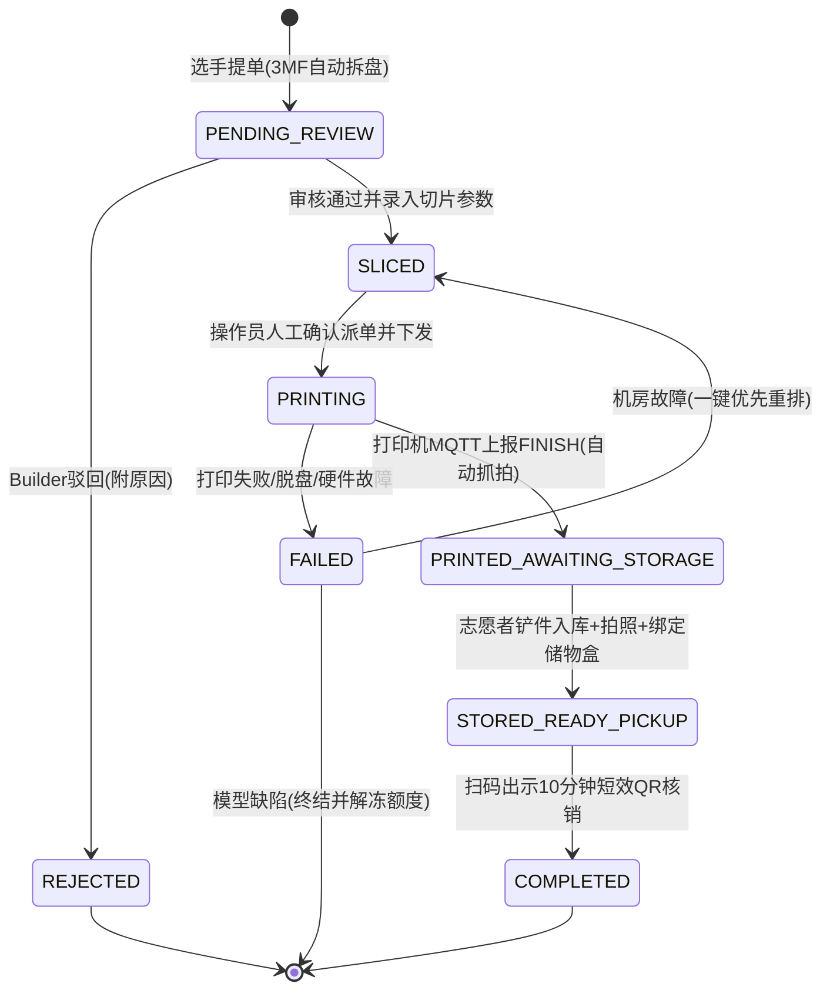
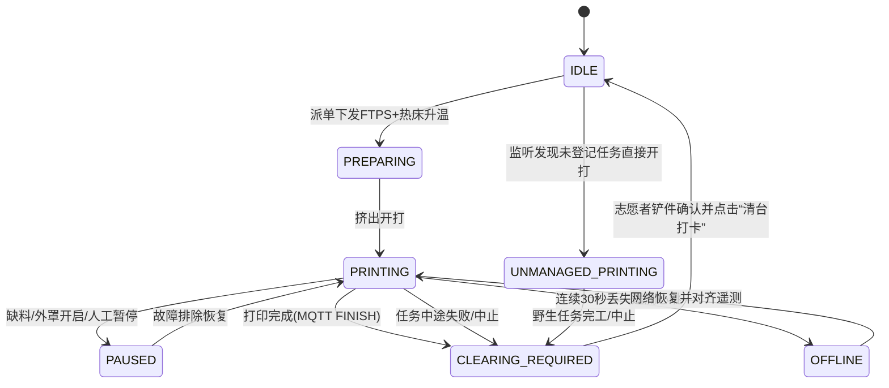

# PlateRelay 架构规范与开发指南 (agent.md)

本文件为 PlateRelay 系统的核心技术架构与业务规范文档，用于约束系统设计与工程实现。AI 助手与开发人员在编写、重构或审查代码时，**必须严格遵守**本文档定义的业务边界、去队伍化数据模型、双状态机及硬件集成规范。

> ⚠️ **【AI 助手与开发阶段核心指令】**
> **当前阶段必须 100% 聚焦于“黑客松赛事场景（Event Mode）”的落地实现！**
> 高校实验室、创客空间与商业农场等场景**仅做接口预留与架构扩展兼容性考虑**。在后续编码、生成接口与设计数据流时，**严禁超前开发、过度设计或引入农场/实验室特有的未定需求（如外部快递物流 SDK、复杂计费审批流等）**。一切以保障黑客松现场比赛稳定、极简、高可用交付为第一前提！
---

## 1. 业务边界与核心设计原则

### 1.1 业务定位：局域网共享 3D 打印服务中枢 (Shared 3D Print Fleet Infrastructure)
PlateRelay 是一套面向多用户的**局域网“共享 3D 打印服务中枢”**。其核心理念是将物理空间中分散的多台 3D 打印机与储物设施，抽象为一个对终端用户即开即用、公平流转的“共享打印集群”。
- **共享中枢本质**：类似校园/写字楼共享文印服务，系统对用户身份做去组织化轻量抽象，用户按需提单排队；但针对 3D 打印独特的物理属性，系统在底层强力管控**人工审核防撞机、切片机型强匹配、AMS 槽位耗材对齐、热床清台防线与防错储物盒安全出库**。
- **核心落地场景**：
  - **3D 黑客松赛事（当前最高优先级）**：典型的高并发、强时效、快节奏的“现场临时共享打样中心”。
  - **高校实验室 / 创客空间**：日常运转的“院系/课题组共享打样中心”。
  - **中小型 3D 打印农场**：集约化、防差错的“客户加工排单中枢”。

### 1.2 边界收敛与“减法”铁律
- **彻底“去队伍化”（Zero-Team Domain）**：
  - 系统内**严禁存在任何 `teams` 实体表或队伍字段**。
  - 参赛选手、实验室成员均被抽象为独立自然人提交者（`submitter`）。
  - 外部黑客松若允许选手自由组队/换队，该逻辑完全由外部 Passport 系统处理；PlateRelay 对外部队伍信息做**零感知与防腐丢弃**。
- **严格剔除复杂财务进销存**：严禁引入销售利润率、发票核销、客户账期、税率等财务逻辑。
- **专注五大核心物理流转**：
  1. 谁在打（自然人提单生命周期与审计追溯）。
  2. 用哪台打（切片机型强绑定匹配、AMS 多色供料槽位匹配）。
  3. 花了多少料与电（按克精确折算耗材成本与整机电费）。
  4. 机器是否被占用或卡死（遥测监听、清台防线、野生任务隔离、断网自愈）。
  5. 谁来操作、留底与取件（双照留底、独占储物盒/溢出暂存池、短时效动态凭证核销）。

### 1.3 架构演进策略：微内核 + 可插拔策略 (Microkernel + Strategy Architecture)
系统采用“**微内核专注物理流转，业务策略高度模块化**”的设计理念。
- **不可变微内核 (Core Engine)**：拓竹 MQTT/FTPS 协议驱动、切片 3MF 内存解包、双状态机骨架、对象存储抽象与不可变审计流水。
- **可插拔策略层 (Pluggable Policies)**：并发控制（`ConcurrencyPolicy`）、排单调度（`SchedulePolicy`）、履约交付（`FulfillmentPolicy`）。
- **落地实施节奏**：
  - **v1 优先聚焦**：全系统优先交付完备的**黑客松赛事场景（Event Mode）**，所有功能与交互以此为最高优先级。
  - **通用化设计留足空间**：实验室（Lab）与农场（Farm）不在此阶段做过度实现，但策略接口必须预留清晰契约，确保未来扩展无需推翻核心架构。
  - **场景预设切换**：单实例通过环境变量 `WORKSPACE_PROFILE=event|lab|farm` 注入对应的策略组件。
---

## 2. 身份、权限与防腐层体系


### 2.1 账户与 OAuth 防腐隔离 (Anti-Corruption Layer)
- 系统采用原生账户体系为主（支持密码哈希登录），外部身份平台仅作为登录扩展。
- **外部 OAuth 防腐层**：对接外部黑客松 Passport 或 OIDC 时，系统仅提取用户全局唯一标识（`sub` / `external_id`）、显示名称（`display_name`）、邮箱/手机号及资格断言（如 `is_participant: true`）。**一律强制丢弃并忽略任何队伍、赛道、分组等组织上下文字段**。
- 本地 `users` 表与独立关联表 `user_oauth_bindings` 维系绑定关系。

### 2.2 基于能力的内生 ACL (Capability-based ACL)
系统定义三类基准角色，底层接口校验细粒度权限能力（Capability）：

| 角色 | 标识 | 权限能力代码 (Capabilities) | 职责与场景 |
| :--- | :--- | :--- | :--- |
| **提交者** | `submitter` | `job:submit`, `job:view_own`, `job:cancel_own` | 参赛选手 / 实验室学生。仅能管理和查看本人的工单及取件凭证。 |
| **操作员** | `operator` | `job:review`, `job:dispatch`, `job:abort`, `printer:operate`, `storage:manage`, `storage:checkout` | 黑客松 Builder / 实验室管理员。切片审核、机床维护、清台打卡、仓储核销。 |
| **系统管理员** | `admin` | `*` (全权限，包含 `system:config`, `user:manage`) | 赛事主理人 / 实验室主任。全局参数配置、机台注册、耗材主档管理。 |

### 2.3 动态并发限额与反霸凌调度防线
为杜绝去队伍化后同组人员通过多个账号抢占全场机床：
1. **提交者活跃并发限制（动态可配置）**：
   - 用户处于 `PENDING_REVIEW`、`SLICED`、`PRINTING` 状态的活跃工单总数受后台配置项 `system_settings.max_active_jobs_per_user` 动态约束。
   - **黑客松模式下默认值为 1 盘**，管理员可在后台根据机群负荷动态调整（如放宽至 2 盘），**严禁在代码中写死常量数值**。
2. **提单锁解冻判定（节点 A）**：当且仅当上一盘工单物理打印完毕且完成入库移入暂存区（状态流转为 `STORED_READY_PICKUP`）时，系统才解冻该用户的下一次排产提单权限。
3. **仓储积压反压拦截**：若单用户名下处于 `STORED_READY_PICKUP`（已入库但未取件）的工单数量达到上限（`system_settings.max_uncollected_jobs_per_user`，默认 2），系统暂停其提单权限，强制其前往领料台核销出库。
---

## 3. 双状态机与物理隔离工作流

系统采用“工单生命周期”与“打印机物理状态”双状态机解耦联动机制。

### 3.1 工单生命周期状态机 (Job State Machine)



#### 工单流转与业务约束
1. **切片生态严格校验与多盘自动拆解**：
   - 提单入口严格限定 **BambuStudio / OrcaSlicer** 切片生成的 `.gcode.3mf`，且必须包含合法的 `Metadata/slice_info.config`。
   - 若检测到工程包含 $N$ 个盘（Plate 1..N），系统自动“裂变”生成 $N$ 张独立的子工单（共享同一批次流水号 `batch_sn`，但具备独立 `job_sn`、独立生命周期与独立审批排期）。
2. **`PENDING_REVIEW` -> `SLICED`**：支持盘级独立审核。Builder 可单独批准合格盘次排产，对有瑕疵盘次单独驳回 `REJECTED` 并附修改建议。
3. **默认 FIFO 排单与手工置顶**：通过审核的工单按 `approved_at` 顺序进入待排队列。操作员看板支持可视化拖拽调序或一键置顶派发。
4. **`SLICED` -> `PRINTING`（派单原子回滚与硬件强绑定）**：
   - **硬件模型强匹配锁 (Model-Lock)**：系统强校验切片元数据中的目标机型（如 X1-Carbon / A1-Mini）、热床尺寸与喷嘴口径必须与派发机台完全一致，否则禁用派发。
   - **原子回滚防线**：操作员点击确认派发后，FTPS 上传超时（>60s）或 MQTT 指令未在 10s 内响应时，工单状态瞬间原子回滚至 `SLICED` 并保留队列原位，机台重置为 `IDLE`。
5. **`FAILED`（故障归因与责任划分）**：
   - **机房/硬件原因**：喷嘴堵塞、热床断电、机台断料。操作员一键转派重排，工单重置为 `SLICED` 并插入队首优先排打，不占用选手的提单并发额度。
   - **模型/切片缺陷**：悬垂过大脱盘、壁厚过薄断裂。工单正式终结，释放该选手的并发锁，附失败照片通知选手修改后重新排队。
6. **`PRINTED_AWAITING_STORAGE`**：MQTT 上报 `FINISH` 瞬间，系统异步调用 `go2rtc` 快照 API 获取机内完工照（`finish_snapshot_url`），超时 3 秒降级放行。
7. **`STORED_READY_PICKUP`**：志愿者清台铲件，拍摄实物入库照（`storage_photo_url`），绑定储物盒或溢出暂存袋。此时**正式解冻提交者的下一盘提单权限**。
8. **`COMPLETED`（10 分钟短效动态核销码）**：选手打开领料页面，前端按动态 Token 渲染取件二维码（默认时效 10 分钟，界面倒计时静默刷新）。领料台扫码枪核销出库。

### 3.2 打印机物理状态机 (Printer State Machine)



#### 打印机物理状态约束
- **`CLEARING_REQUIRED`（清台防线）**：任务结束或失败后强制锁定，**严禁接受任何新工单派发**，直至志愿者物理铲件并在界面确认清台。
- **机身 SD 卡自愈清理**：机台进入 `CLEARING_REQUIRED` 或恢复 `IDLE` 后，后台异步通过 FTPS 自动删除机身 SD 卡上本次任务对应的已完工 `.gcode.3mf` 文件，防止长时间高频运行导致 SD 卡爆满停机。
- **`OFFLINE`（网络中断容错）**：连续 30 秒未收到 MQTT 遥测上报标记为 `OFFLINE`；**严禁将正在打印的工单置为失败**。后台协程以指数退避重连；恢复后自动校正物理状态。
- **`UNMANAGED_PRINTING`（外部野生任务温和隔离策略）**：
  - 监听机台脱机插 SD 卡或 Bambu Studio 直发开打。
  - 系统高亮告警并记录其实际运行时长与层数，标记为“耗材待核对”。
  - 完工后转入 `CLEARING_REQUIRED`，**由操作员在清台打卡时在界面快捷确认/录入消耗耗材，严禁无切片元数据下的自动盲扣**。

---

## 4. 仓储履约与交付策略 (Fulfillment & Storage)

### 4.1 履约抽象层与场景实现节奏 (`FulfillmentAdapter`)
系统将物理交付抽象为 `FulfillmentAdapter` 契约，支持不同物理环境的取件/出库流转：
1. **赛事/智能柜履约 (`LockerFulfillment`) —— v1 核心落地**：
   - **实体库位独占**：维护实体库位 `storage_bins`（如 `BIN-A01` ~ `BIN-A40`），入库时原子锁定单个 `FREE` 库位转为 `OCCUPIED`。
   - **溢出暂存防死锁机制**：当现场所有实体储物盒全部处于 `OCCUPIED` 时，为防止阻塞机台清台，系统允许志愿者选择虚拟溢出库位 `BIN-OVERFLOW`，操作员使用自粘打印机打印装袋条码标签贴于收纳袋入库，机台即可顺利翻转回 `IDLE` 接单。
   - **不记名数字凭证机制（Bearer QR）**：取件二维码基于前端轻量签名 Token 渲染（载荷含 `job_id`, `salt`, `exp = now + 10min`，时效后台可配），由提交者展示或转发给同伴代领。
   - **出库清空防呆二次确认**：志愿者在领料台扫码核验照片交付物料后，界面**强制弹出大字防呆提示“请目视确认储物盒 [BIN-xxx] 内部已完全清空”**，志愿者点击确认后，系统才在同一事务中将库位状态重置为 `FREE`。
2. **农场流转履约 (`FarmStagingFulfillment`) —— v1 基础厂内流转**：
   - 完工后仅执行厂内工序流转（质检、打包、入成品暂存区与扫码标记交付）。
   - **物流与外部快递对接（如顺丰/菜鸟 API 面单打印）**：作为独立 Feature 后续扩展，代码层仅在 `FulfillmentAdapter` 中预留 `LogisticsFulfillment` 扩展点，v1 严禁提前引入重型外部物流 SDK。
---

## 5. 硬件抽象层 (HAL) 与拓竹接入规范

### 5.1 现场局域网容器化中枢拓扑
系统采用单机局域网部署（Docker Compose 一键启动），彻底解耦视频与核心业务：

```mermaid
flowchart TD
    subgraph DockerComposeHost[现场局域网服务器 (Docker Compose)]
        Backend[PlateRelay 后端 (FastAPI + AsyncIO)]
        MinIO[(MinIO 对象存储容器)]
        Go2rtc[go2rtc 流媒体与抓拍伴生容器]
        PG[(PostgreSQL 16 数据库)]
    end

    subgraph BambuFleet[拓竹局域网机群]
        P1[Bambu X1-Carbon]
        P2[Bambu P1S]
        P3[Bambu A1-Mini]
    end

    Backend -->|MQTT TLS:8883| BambuFleet
    Backend -->|FTPS:990| BambuFleet
    Go2rtc -->|RTSP:322 / MJPEG:6000| BambuFleet
    Backend -->|REST API 抓拍提取| Go2rtc
    Backend -->|S3 API| MinIO
    Backend -->|asyncpg| PG
```

### 5.2 拓竹机群协议与长连接收敛
- **单一异步常驻进程架构**：Python 3.12+ FastAPI 后端内部由单例 `FleetManager` 协程池集中管理所有机台的 MQTT TLS 8883 长连接与周期心跳，严禁多进程模型导致的多实例重复连接机台。
- **文件下发 (FTPS)**：端口 Explicit FTPS 990，TLS 握手，凭据 `bambu:<access_code>`，下发至机身 SD 卡 `/` 目录后由 MQTT 触发 `project_file` 打印。
- **流媒体网关 (`go2rtc`)**：X1/P1/A1 视频流全部由 `go2rtc` 容器集中接入与转换，后端仅通过 HTTP REST 接口请求静帧（`GET /api/frame.jpeg?src=...`），主进程零视频编解码负担。

---

## 6. 耗材资产与多色精准分账引擎

### 6.1 多色料槽与工单消耗明细
- **AMS 槽位绑定**：系统监听 MQTT `ams.tray` 信息自动建档或更新机台槽位映射（`printer_spool_slots`）。
- **多色工单消耗明细表 (`job_spool_usages`)**：在提单解包 `.gcode.3mf` 时，提取各料槽（Slot 0~3 / 外挂）的预估克数写入子表。
- **核算与扣减策略**：
  - **任务派单开打 (`PRINTING`)**：锁定机台，冻结关联料盘的预估耗材克数。
  - **任务正常完工 (`FINISH`)**：解冻并按切片真实克数从 `spools.current_weight_g` 正式扣减（含模型主体 + 冲刷擦料塔/吐丝）。
  - **任务中途失败 (`FAILED`)**：
    $$\text{ActualDeduction}_{i} = \text{EstimatedGrams}_{i} \times \max\left(\text{mc\_percent}, \frac{\text{layer\_num}}{\text{total\_layer\_num}}\right)$$
  - **单件综合成本公式**：
    $$\text{Cost}_{\text{total}} = \sum (\text{ActualWeight}_{i} \times \text{UnitPricePerGram}_{i}) + \left(\frac{\text{Duration}_{\text{sec}}}{3600} \times \frac{\text{RatedPower}_{\text{W}}}{1000} \times \text{ElectricityPrice}_{\text{kWh}}\right)$$
    其中 `ElectricityPrice` 从 `system_settings` 表动态读取。

---

## 7. 存储抽象与全链路审计

### 7.1 对象存储抽象层 (`StorageBackend`)
系统代码严禁直接读写本地磁盘文件，必须统一通过 `StorageBackend` 抽象基类操作：
- `upload(file_data: bytes, path: str, content_type: str) -> str`
- `download(path: str) -> bytes`
- `delete(path: str) -> bool`
- `get_url(path: str, expires_in: int = 3600) -> str`
默认实现为 `S3StorageBackend`（开箱直连 Docker 编排内的 MinIO 容器，兼容外部 S3）。

### 7.2 节点文件资产归档 (`job_artifacts`)
1. **提单节点**：原始切片工程包 `.gcode.3mf` + 提取自 3MF 内的各盘高清预览图（`Metadata/plate_*.png`）。
2. **打印与完工节点**：机身摄像头完工瞬间抓拍照（`finish_snapshot.jpg`）。
3. **入库与核销节点**：志愿者拍摄的实物在储物篮/收纳袋内的照片（`storage_photo.jpg`）。

---

## 8. 数据库实体设计 (PostgreSQL 16)

系统严格基于 PostgreSQL 16 关系实体与 JSONB，完全剔除队伍相关表结构。

```sql
-- 1. 用户表 (原生账号凭据，去队伍化)
CREATE TABLE users (
    id UUID PRIMARY KEY DEFAULT gen_random_uuid(),
    username VARCHAR(64) UNIQUE NOT NULL,
    hashed_password VARCHAR(255) NOT NULL,
    display_name VARCHAR(64) NOT NULL,
    avatar_url VARCHAR(512),
    role VARCHAR(32) NOT NULL DEFAULT 'submitter', -- submitter / operator / admin
    contact_phone VARCHAR(32),
    email VARCHAR(128),
    is_active BOOLEAN NOT NULL DEFAULT TRUE,
    created_at TIMESTAMPTZ NOT NULL DEFAULT NOW(),
    updated_at TIMESTAMPTZ NOT NULL DEFAULT NOW()
);

-- 2. 外部 OAuth 绑定表 (解耦第三方 Passport/飞书)
CREATE TABLE user_oauth_bindings (
    id UUID PRIMARY KEY DEFAULT gen_random_uuid(),
    user_id UUID NOT NULL REFERENCES users(id) ON DELETE CASCADE,
    provider VARCHAR(32) NOT NULL, -- hackathon_passport, feishu, github
    oauth_sub VARCHAR(128) NOT NULL,
    oauth_raw_claims JSONB,
    created_at TIMESTAMPTZ NOT NULL DEFAULT NOW(),
    CONSTRAINT uq_user_provider UNIQUE (user_id, provider),
    CONSTRAINT uq_provider_sub UNIQUE (provider, oauth_sub)
);

-- 3. 全局动态配置表
CREATE TABLE system_settings (
    key VARCHAR(64) PRIMARY KEY,
    value JSONB NOT NULL,
    description VARCHAR(255),
    updated_at TIMESTAMPTZ NOT NULL DEFAULT NOW()
);

-- 4. 打印机台表
CREATE TABLE printers (
    id UUID PRIMARY KEY DEFAULT gen_random_uuid(),
    name VARCHAR(64) NOT NULL,
    serial_number VARCHAR(64) UNIQUE NOT NULL,
    model VARCHAR(32) NOT NULL, -- X1C, P1S, A1_MINI, MANUAL
    ip_address VARCHAR(45) NOT NULL,
    access_code VARCHAR(64),
    status VARCHAR(32) NOT NULL DEFAULT 'IDLE', -- IDLE, PREPARING, PRINTING, PAUSED, CLEARING_REQUIRED, UNMANAGED_PRINTING, OFFLINE, ERROR
    bed_width_mm INT NOT NULL DEFAULT 256,
    bed_depth_mm INT NOT NULL DEFAULT 256,
    bed_height_mm INT NOT NULL DEFAULT 256,
    nozzle_diameter_mm NUMERIC(3, 2) NOT NULL DEFAULT 0.40,
    rated_power_w INT NOT NULL DEFAULT 150,
    is_active BOOLEAN NOT NULL DEFAULT TRUE,
    last_telemetry_at TIMESTAMPTZ,
    created_at TIMESTAMPTZ NOT NULL DEFAULT NOW()
);

-- 5. 线盘耗材库
CREATE TABLE spools (
    id UUID PRIMARY KEY DEFAULT gen_random_uuid(),
    tray_uuid VARCHAR(64) UNIQUE,
    brand VARCHAR(64) NOT NULL DEFAULT 'Bambu',
    material VARCHAR(32) NOT NULL, -- PLA, PETG, ABS, TPU
    color_hex VARCHAR(8) NOT NULL,
    initial_weight_g NUMERIC(8, 2) NOT NULL DEFAULT 1000.0,
    current_weight_g NUMERIC(8, 2) NOT NULL DEFAULT 1000.0,
    unit_price_cny NUMERIC(8, 2) NOT NULL DEFAULT 100.0,
    rfid_raw_payload JSONB,
    created_at TIMESTAMPTZ NOT NULL DEFAULT NOW()
);

-- 6. 打印机料槽挂载表 (AMS / 外部料架)
CREATE TABLE printer_spool_slots (
    id UUID PRIMARY KEY DEFAULT gen_random_uuid(),
    printer_id UUID NOT NULL REFERENCES printers(id) ON DELETE CASCADE,
    slot_index INT NOT NULL DEFAULT 0, -- 0-3 对应 AMS Tray 0~3, -1 为外挂
    spool_id UUID REFERENCES spools(id) ON DELETE SET NULL,
    ams_reported_remain_percent INT,
    updated_at TIMESTAMPTZ NOT NULL DEFAULT NOW(),
    CONSTRAINT uq_printer_slot UNIQUE (printer_id, slot_index)
);

-- 7. 储物盒库位表
CREATE TABLE storage_bins (
    id UUID PRIMARY KEY DEFAULT gen_random_uuid(),
    bin_code VARCHAR(32) UNIQUE NOT NULL, -- 如 BIN-A01, BIN-OVERFLOW
    is_overflow_pool BOOLEAN NOT NULL DEFAULT FALSE,
    status VARCHAR(16) NOT NULL DEFAULT 'FREE', -- FREE, OCCUPIED
    description VARCHAR(128),
    updated_at TIMESTAMPTZ NOT NULL DEFAULT NOW()
);

-- 8. 工单主表 (多盘独立子工单，去队伍化)
CREATE TABLE jobs (
    id UUID PRIMARY KEY DEFAULT gen_random_uuid(),
    job_sn VARCHAR(32) UNIQUE NOT NULL, -- 单盘唯一编号
    batch_sn VARCHAR(32) NOT NULL, -- 同一批次上传工程的共享流水号
    submitter_id UUID NOT NULL REFERENCES users(id),
    assigned_printer_id UUID REFERENCES printers(id),
    status VARCHAR(32) NOT NULL DEFAULT 'PENDING_REVIEW',
    storage_bin_id UUID REFERENCES storage_bins(id),
    target_printer_model VARCHAR(32) NOT NULL, -- 切片锁定的机型
    plate_index INT NOT NULL DEFAULT 1,
    plate_name VARCHAR(64),
    estimated_duration_sec INT,
    estimated_filament_grams NUMERIC(8, 2),
    actual_filament_grams NUMERIC(8, 2),
    estimated_cost_cny NUMERIC(8, 2),
    finish_snapshot_url VARCHAR(512),
    storage_photo_url VARCHAR(512),
    reject_reason TEXT,
    failure_type VARCHAR(32), -- HARDWARE_FAULT, MODEL_DEFECT
    approved_at TIMESTAMPTZ, -- 用于默认 FIFO 排序
    created_at TIMESTAMPTZ NOT NULL DEFAULT NOW(),
    updated_at TIMESTAMPTZ NOT NULL DEFAULT NOW()
);

-- 9. 工单耗材消耗明细关联表 (多色分账)
CREATE TABLE job_spool_usages (
    id UUID PRIMARY KEY DEFAULT gen_random_uuid(),
    job_id UUID NOT NULL REFERENCES jobs(id) ON DELETE CASCADE,
    spool_id UUID REFERENCES spools(id) ON DELETE SET NULL,
    slot_index INT NOT NULL,
    material VARCHAR(32) NOT NULL,
    color_hex VARCHAR(8) NOT NULL,
    estimated_grams NUMERIC(8, 2) NOT NULL DEFAULT 0.0,
    actual_grams NUMERIC(8, 2) NOT NULL DEFAULT 0.0,
    created_at TIMESTAMPTZ NOT NULL DEFAULT NOW()
);

-- 10. 审批与流转过程文件归档表
CREATE TABLE job_artifacts (
    id UUID PRIMARY KEY DEFAULT gen_random_uuid(),
    job_id UUID NOT NULL REFERENCES jobs(id) ON DELETE CASCADE,
    artifact_type VARCHAR(32) NOT NULL, -- GCODE_3MF, PLATE_PREVIEW, FINISH_SNAPSHOT, STORAGE_PHOTO
    file_name VARCHAR(255) NOT NULL,
    file_path VARCHAR(512) NOT NULL, -- 对象存储 Key
    file_size_bytes BIGINT NOT NULL,
    uploader_id UUID REFERENCES users(id),
    created_at TIMESTAMPTZ NOT NULL DEFAULT NOW()
);

-- 11. 不可变操作审计流
CREATE TABLE job_audit_logs (
    id UUID PRIMARY KEY DEFAULT gen_random_uuid(),
    job_id UUID NOT NULL REFERENCES jobs(id) ON DELETE CASCADE,
    operator_id UUID REFERENCES users(id),
    operator_display_name VARCHAR(64),
    action VARCHAR(64) NOT NULL,
    from_status VARCHAR(32),
    to_status VARCHAR(32),
    client_type VARCHAR(32) NOT NULL DEFAULT 'web_desktop',
    payload JSONB,
    created_at TIMESTAMPTZ NOT NULL DEFAULT NOW()
);

CREATE INDEX idx_jobs_submitter_status ON jobs(submitter_id, status);
CREATE INDEX idx_jobs_batch_sn ON jobs(batch_sn);
CREATE INDEX idx_jobs_status_approved ON jobs(status, approved_at);
CREATE INDEX idx_printers_serial ON printers(serial_number);
```

---

## 9. 内部模块化与进程内事件总线规范

为确保全系统松耦合，后端代码划分为五大内部模块，模块间通信必须通过进程内异步事件总线（`EventBus`），严禁跨模块强行写入数据库：

```
src/
├── core/             # 配置、数据库会话、StorageBackend 抽象、EventBus 中枢
├── modules/
│   ├── identity/     # 用户、内生 ACL 拦截器、OAuthProvider 适配器
│   ├── fleet/        # FleetManager、MQTT 长连接协程、FTPS 下发、go2rtc 抓拍客户端
│   ├── jobs/         # 3MF 解包器、双状态机引擎、FIFO/拖拽排单队列、模型锁匹配
│   ├── storage/      # 储物盒事务锁、BIN-OVERFLOW 溢出、10分钟动态 QR 签发与核销
│   └── notifier/     # 大屏 WebSocket 广播、邮件/Webhook 事件通知适配器
```

### 核心领域事件契约
- `UserSubmitted3MFEvent`：提单触发解包并拆分独立盘次子工单。
- `JobApprovedEvent`：审核通过，工单进入待排产队列。
- `JobDispatchFailedEvent`：FTPS 或 MQTT 派发失败，触发事务原子回滚至 `SLICED`。
- `PrinterJobFinishedEvent`：机台 MQTT 上报完工，触发 `go2rtc` 抓拍并流转工单至 `PRINTED_AWAITING_STORAGE`。
- `PrinterTelemetryLostEvent`：机台 30 秒无心跳，转入 `OFFLINE`，保持在打任务运行。
- `JobStoredEvent`：实物入库拍照并绑定库位，触发解冻提交者的下一盘提单权限。
- `JobPickedUpEvent`：核销成功，防呆校验通过后释放储物盒为 `FREE`。

---

## 10. AI 编码防坑与强制约束

在生成和修改代码时，**必须严格遵守**以下架构铁律：
1. **绝对聚焦赛事落地，严禁超前实现**：代码实现必须全力服务于黑客松赛事模式（`WORKSPACE_PROFILE=event`）。实验室、创客空间与农场场景仅保留策略抽象契约（如 `FulfillmentAdapter` 扩展点），**严禁提前编写未要求的外部物流、复杂学期配额或多层级审批代码**。
2. **严禁引入队伍概念**：数据库、领域模型、DTO、API 中禁止出现 `team`、`team_id`、`team_name` 字段；系统仅对提交人自然人 ID 负责。
3. **强制使用对象存储抽象**：所有文件（切片、底片、入库照）存取必须通过 `StorageBackend` 接口进行，严禁直接 `open()` 本地磁盘文件。
4. **动态并发策略校验（严禁硬编码常量）**：提单前必须原子查询该用户活跃盘数（`PENDING_REVIEW` / `SLICED` / `PRINTING`），并与 `system_settings.max_active_jobs_per_user`（默认 1）动态比对；超限时抛出 400 业务异常拒绝提单，**代码中严禁硬编码 `count >= 1` 的数值死限**。
5. **切片机型强校验锁**：派单前必须比对 `jobs.target_printer_model == printers.model`，机型或热床尺寸不兼容严禁放行。
6. **派单原子回滚**：FTPS 上传或 MQTT 下发指令任何一步抛出异常或超时，必须在 `try...except` 块中立即将 `jobs.status` 回滚为 `SLICED`，`printers.status` 回归 `IDLE`。
7. **完工 SD 卡自动清理**：任务完工或清台后，必须异步向机台 FTPS 发送删除指令，清理机身 `/` 目录下的切片缓存。
8. **抓拍容错降级**：调用 `go2rtc` 快照时设置 ≤ 3 秒异步超时，失败仅记录警告日志，绝不可阻塞工单推进至待入库。
9. **Stateless API 与 JWT**：全接口遵循 RESTful 规范，基于 `Bearer JWT` 鉴权，严禁耦合服务端 Session / Cookie。
10. **内存 ZIP 解包**：解析 `.gcode.3mf` 时，直接在内存（`io.BytesIO`）利用 `zipfile` 提取 `Metadata/slice_info.config` 与预览图片，严禁向本地磁盘写入临时散落文件。
