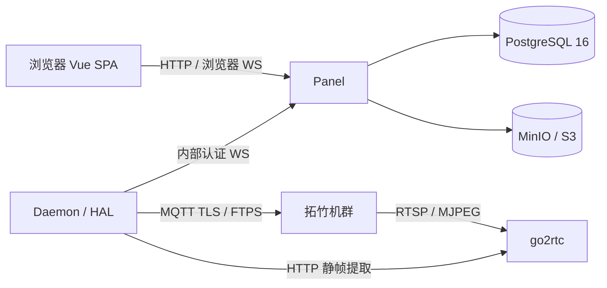

# PlateRelay 技术架构

本文件定义技术边界与目标契约，不代表全部已经实现。当前实现、阶段范围与验收以 [ROADMAP](../ROADMAP.md) 为准；常驻工程门禁见 [agent.md](../agent.md)。业务规则见 [领域规范](domain.md)，表结构见 [数据模型](data-model.md)。

## 职责与拓扑

- **Panel**：FastAPI + AsyncIO 业务中枢，负责认证、工单状态、排单并发、PostgreSQL/MinIO 持久化，并托管 Vue 3 SPA；对外统一提供 `http://host:8000`。
- **Daemon**：独立 Python 3.12+ 异步硬件网关，管理机台长连接、文件下发与 HAL Simulator。无数据库或持久化依赖，仅通过认证 JSON/WebSocket 与 Panel 通信。
- 单机 Docker Compose 容器组部署；Panel 与 Daemon 是独立常驻进程。场景策略由 `WORKSPACE_PROFILE=event|lab|farm` 注入，当前只实现 event，其他模式仅保留扩展契约。

## 通信与硬件

| 通道 | 目标契约 |
| --- | --- |
| Daemon → Panel | 主动连接 `ws://panel:8000/daemon/ws?token=SECRET`（Compose 地址示例），以预共享 Token 认证；`REGISTER` 携带机台列表，`TELEMETRY_BATCH` 批量上报遥测，断线指数退避重连。 |
| 遥测频率 | 目标为 1 秒窗口内节流批量上报；当前周期发送实现与窗口算法的区别见下方待决项。 |
| Panel → 浏览器 | `/api/v1/ws/dashboard` 广播 `FLEET_SNAPSHOT`、`FLEET_UPDATE`；Daemon 断开时将其机台标记为 `OFFLINE`。 |
| 机台控制 | MQTT TLS 8883；FTPS 990、凭据 `bambu:<access_code>`，上传到机身 SD 卡 `/` 后由 MQTT `project_file` 触发打印。仅在获准的控制阶段实现。 |
| 视频与抓拍 | go2rtc 统一接入 RTSP 322 / MJPEG 6000 并转换；Panel/Daemon 仅以 HTTP 提取静帧，接口为 `GET /api/frame.jpeg?src=...`，主进程不做视频转码。 |

HAL 同时容纳模拟器 `Simulator` 与真实机台适配器 `BambuPassive`。模拟器目标覆盖热床/喷头升温、层数与进度推进、AMS 余量递减、完工转入 `CLEARING_REQUIRED`；真实机台配置包含 IP、Serial、Access Code。未连接或端口不可用时保持 `OFFLINE`，不得用模拟数据冒充真实遥测。

监控阶段的物理只读禁令见 [agent.md](../agent.md)；不得因为本节描述了未来控制协议而提前下发指令。抓拍容错、派单回滚与清台规则见 [工单状态机](domain.md#工单状态机) 和 [机台状态机](domain.md#机台状态机)。

## 技术栈与依赖

- 后端使用 FastAPI、AsyncIO、Pydantic v2 / `BaseSettings` 强类型环境配置，支持优雅停机；持久化设计基于 PostgreSQL 16、JSONB、asyncpg 与 MinIO/S3。
- 前端使用 Vue 3、TypeScript、Tailwind CSS、Vite。开发端口 5173，反向代理 API/WS；生产输出 `panel/backend/dist`，由 FastAPI 托管并提供 SPA 路由回退。当前视觉依据仅在 [ROADMAP](../ROADMAP.md#当前界面依据) 维护。
- 指定库基线：HTTP 使用 `httpx`；硬件使用 `paho-mqtt` + 标准库 `ftplib`；3MF 使用 `zipfile`；鉴权使用 `pyjwt` + `bcrypt`。这是设计选型，不表示所有库已经安装或功能已经实现。
- 工单/机台双状态机、自然人 ACL、并发锁、3MF 解析、库位事务核销由原生协程及进程内 EventBus 实现，不引入 transitions、celery 等通用工作流框架。协议驱动、哈希、QR、JWT、对象存储可复用成熟库。
- 依赖携带超过 30% 无关实体/抽象，或迫使模型引入队伍、复杂财务等冗余概念时，放弃整套依赖，采用最小契约实现。
- 目标功能若只需 ≤50 行无状态代码，必须自研，不为微型逻辑引入第三方包；优先 Python 3.12+ 标准库与既有依赖。
- 所有 I/O 必须兼容 AsyncIO；必须使用同步库时通过 `asyncio.to_thread` / `run_in_executor` 隔离，不阻塞事件循环。不引入 Redis、RabbitMQ 等额外常驻中间件。
- 新增依赖须兼容 GPLv3，许可证限 MIT、Apache 2.0、BSD、LGPL、GPL；禁止 NC 或专有排他条款。须为纯 Python，或同时提供 `win_amd64`、`manylinux_x86_64` Wheel，不依赖安装时本地 MSVC/gcc 编译。
- 优先官方标准协议客户端，避免缺乏维护的转封装 SDK。不得以功能更强为由推翻稳定选型；依赖变更审批流程见 [agent.md](../agent.md#工程门禁)。

## 对象存储

切片、底片、入库照等业务文件必须通过 `StorageBackend`，不得直接 `open()` 本地磁盘。默认 `S3StorageBackend` 连接 Compose 中的 MinIO，也兼容外部 S3。

| 接口 | 契约 |
| --- | --- |
| 上传 | `upload(file_data: bytes, path: str, content_type: str) -> str` |
| 下载 | `download(path: str) -> bytes` |
| 删除 | `delete(path: str) -> bool` |
| 临时地址 | `get_url(path: str, expires_in: int = 3600) -> str` |

`.gcode.3mf` 必须通过 `io.BytesIO` + `zipfile` 在内存解包，提取 `Metadata/slice_info.config` 与预览图，不落地临时散文件。归档类型见 [资产与审计](domain.md#资产与审计)。

## 模块与事务

以下是目标职责划分，不是已存在目录清单：

| 区域 | 职责 |
| --- | --- |
| `panel/backend/core` | 配置、数据库会话、StorageBackend、EventBus |
| `panel/backend/modules/identity` | 用户、能力 ACL、OAuthProvider |
| `panel/backend/modules/fleet` | FleetHub、Daemon 注册认证、机群汇聚、多客户端广播与心跳检测；状态更新需协程安全及并发写锁。旧稿“多租户”语义见待决项。 |
| `panel/backend/modules/jobs` | 3MF 解包（目标文件 `modules/jobs/unpacker.py`）、双状态机、FIFO/拖拽排单、机型匹配 |
| `panel/backend/modules/storage` | 实体/溢出库位、QR 签发与事务核销 |
| `panel/backend/main.py` | FastAPI、WebSocket 入口与静态分发 |
| `panel/frontend` | Vue SPA |
| `daemon/hal`、`daemon/config.py`、`daemon/main.py` | 驱动/模拟器、节点机台配置、异步常驻与遥测上报；控制阶段目标驱动文件为 `hal/bambu_mqtt.py`、`hal/bambu_ftps.py` |

模块间通信使用进程内异步 EventBus，禁止绕过所属模块直接写库。事件名称统一见 [领域事件](domain.md#领域事件)；跨模块原子事务如何满足此边界尚待裁决，不得假定发出事件即完成事务。

## 实施前待决

以下问题保留原要求及冲突，不授权实现者自行选边；进入相关切片前必须确认：

| 问题 | 原要求与待确认边界 |
| --- | --- |
| 跨模块事务 | 禁止跨模块写库，同时要求派单失败时 jobs/printers 原子回滚、核销时工单与库位同事务更新。需明确事务拥有者、聚合边界与 EventBus 协作方式。 |
| 模块数量与耗材归属 | 旧稿称“五大内部模块”，实际只列 identity/fleet/jobs/storage 四项。保留这四项，不凭空增加第五模块；耗材领域归属需确认。 |
| 广播隔离语义 | 旧稿要求“多租户浏览器客户端广播”，但未定义租户实体或隔离规则。保留多客户端广播目标，“多租户”的具体含义待明确，不借此引入队伍或组织模型。 |
| 本地文件禁令 | 旧稿还有“系统代码严禁直接读写本地磁盘”的全局表述，与前端本地资产和静态托管冲突。业务资产强制对象存储不变，禁令是否覆盖静态资源/配置等需确认；本次不改变运行行为。 |
| 遥测节流 | 目标写“1 秒滑动窗口”，当前 `daemon/main.py` 是按间隔周期采集发送。是否需要独立窗口算法，以及离线/恢复时限，须通过契约与运行证据确定，不能宣称已有秒级 SLA。 |
| FTPS 握手模式 | 旧稿指定“Explicit FTPS 990”。保留端口及 TLS 要求，但 Explicit/Implicit 模式需在硬件接入时核对，不能仅凭端口推定握手方式。 |
