# 3 · 核心交互时序图

> 设计层文档第 3 份，共 4 份。与文档 [0](00-scope-and-principles.md)、[1](01-business-rules.md)、[2](02/README.md) 冲突时以上层为准，并修正本文。
>
> 状态：初稿（2026-11-05）。骨架来自追问 Q197–Q200，审阅修正见 Q203–Q216。

## 0. 怎么读

- **本文不新增规则**（Q199、P-06）。每一步都标出来源编号：状态转换 `S-`、规则 `R-`、协议 `MSG-`、接口约定 `API-`、操作 ID（openapi.yaml 的 `operationId`）。画图时发现上层有缺口，先改上层。
- 每个流程一张 Mermaid 时序图，只画正常路径；出错的情况写在图下面的"失败分支"表里。
- 图里省略了每个写请求都带的 `Idempotency-Key`（API-IDEM）和预期状态（API-CONC-02），除非它决定了结果。
- 打印机事件先落到当前打印任务（E-JOB），再按文档 1 §4A.2 的映射表在同一个事务里改订单和打印机。图里写"订单 X、打印机 Y"的地方都是这一步。
- 参与者：

| 简称 | 是谁 |
| --- | --- |
| 申请者 / 现场 / 管理员 | 浏览器里的人 |
| 面板 | NestJS 服务和它的数据库事务 |
| Worker | 面板的解析 worker 线程池（IF-PARSE） |
| 存储 | S3 兼容对象存储（IF-STO） |
| daemon | 场地里的 daemon（IF-ADP 在它里面） |
| 打印机 | 真机 |
| 媒体 | mediamtx（MSG-MEDIA-01） |

| 编号 | 流程 |
| --- | --- |
| SEQ-01 | 提交到审核通过 |
| SEQ-02 | 修改文件 |
| SEQ-03 | 派单到开始打印 |
| SEQ-04 | 停止打印（含开打前停止） |
| SEQ-05 | 取消订单 |
| SEQ-06 | 报错和处理报错 |
| SEQ-07 | 断线、重连和对账 |
| SEQ-08 | 打完、铲件入库、核销 |
| SEQ-09 | 失败后重打 |
| SEQ-10 | daemon 安装注册和连接认证 |
| SEQ-11 | 看实况 |
| SEQ-12 | 归档本期 |

## SEQ-01 提交到审核通过

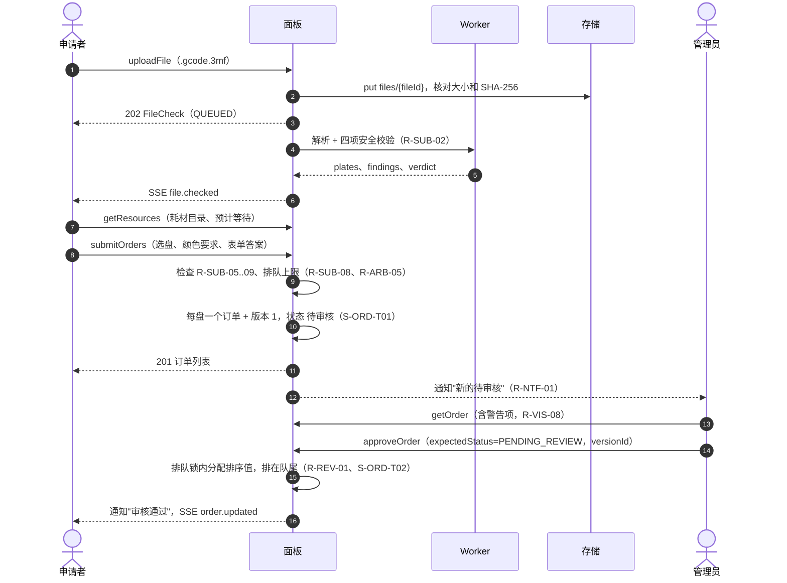

| 步骤 | 失败 | 处理 | 依据 |
| --- | --- | --- | --- |
| 1 | 不是 `.gcode.3mf` / 太大 | 415 `unsupported_file` / 413 | R-SUB-01、API-FILE-01 |
| 5 | 结构损坏、危险指令 | verdict=REJECT，不能提交 | R-SUB-03 |
| 5 | 越界 / 元数据不一致 | 按 CFG-SUB-01、CFG-SUB-06 拒收或警告 | R-SUB-04 |
| 9 | 机型或喷嘴和开放的打印机都对不上 | 422 `rule_violation`（R-SUB-05） | R-SUB-05 |
| 9 | 超过排队上限 | 整次拒绝，422（R-SUB-08） | R-ARB-05 |
| 9 | 表单已被管理员改过 | 409 `version_conflict`，前端重新拉表单 | E-FORM |
| 1 | 手上已有 CFG-SUB-08 − 1 个没提交的文件（默认从第 3 个起） | 422 `captcha_required`，前端弹人机验证后重传 | R-SUB-13、Q236 |
| 8 之前 | 过了 CFG-SUB-07（默认 2 小时）没提交 | 删文件 | R-SUB-10 |
| 14 | 另一个管理员已经审过 | 409 `state_conflict` | API-CONC-02 |
| 14 | 驳回 | rejectOrder，必须填原因 → 已驳回（S-ORD-T03） | R-REV-02 |

## SEQ-02 修改文件

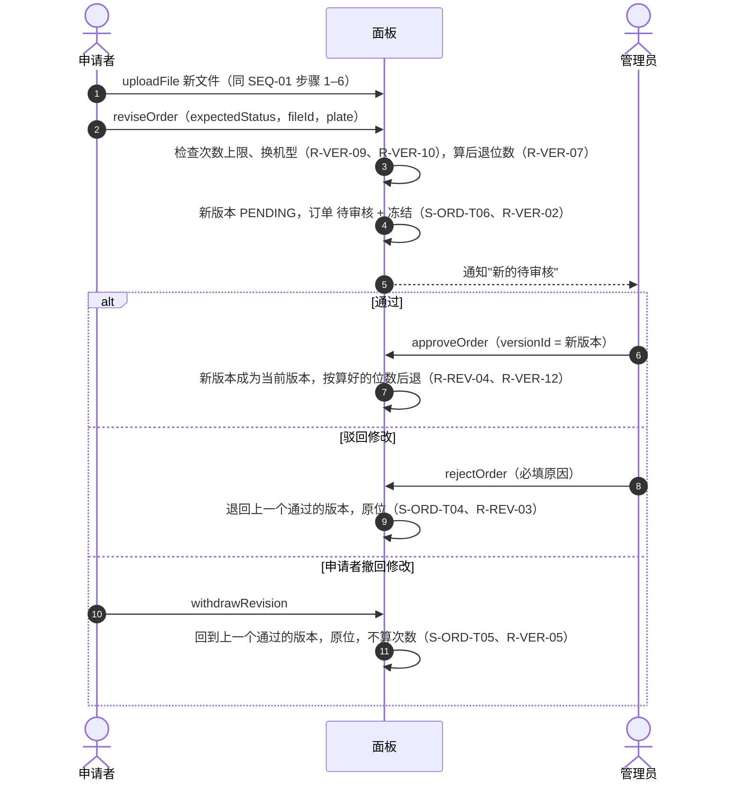

| 步骤 | 失败 | 处理 | 依据 |
| --- | --- | --- | --- |
| 3 | 次数用完 | 422 `rule_violation`（R-VER-09） | R-VER-09 |
| 3 | 已派单、打印中或之后 | 422 `rule_violation`；已派单要请现场人员先停止，回到排队中后再改 | R-VER-04、R-VER-08、Q207 |

恢复旧版本（restoreVersion）走同一套：生成新版本、算一次修改、自动通过、按时长规则后退（S-ORD-T07、R-VER-06），不经过管理员；只能恢复曾经通过的版本。

## SEQ-03 派单到开始打印

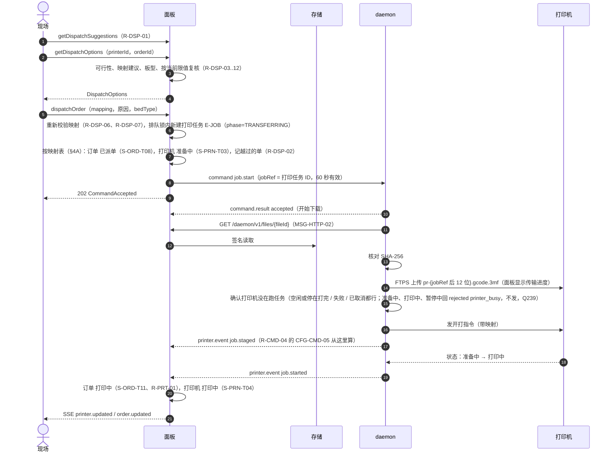

| 步骤 | 失败 | 处理 | 依据 |
| --- | --- | --- | --- |
| 5 | 别人已经派走 / 打印机不空闲 | 409 `state_conflict` | API-CONC-02 |
| 5 | 打印机挂了任何标记（等待处理、失联、存储不足、daemon 需要升级）、在维护中或已停用 | 409 `printer_flagged`（params.flags）；建议和手动派单都一样，派单选项里也不可选 | R-DSP-15、Q233 |
| 6 | 映射有 BLOCK，或有 WARN 没填原因 | 422，不派 | R-DSP-06、R-DSP-07 |
| 6 | 板型和要求不一致没二次确认 | 422 | R-DSP-09 |
| 8 | daemon 不在线 | 409 `printer_unreachable`，不建派单 | API-ASYNC-03 |
| 11–14 | 传文件期间有人点停止 | daemon 中止传输、删掉传了一半的文件、记下这个 jobRef 不再发开打，回 job.cancelled beforeStart=true → 任务结局 STOPPED_BEFORE_START，订单回原位（SEQ-04） | MSG-CMD-START、Q223 |
| 11–14 | 下载或上传失败、哈希不对 | daemon 在同一条命令里自动重试，各最多 3 次，每次超时 CFG-CMD-02；用完回 failed → 下发失败，订单回排队中原位（S-ORD-T09、R-DSP-08），任务结局 SEND_FAILED。开打指令发出后不再重试 | MSG-CMD-START |
| 10 | 命令过期 | daemon 回 expired → 下发失败处理 | MSG-CMD-TTL |
| 15–17 | job.staged 后过了 CFG-CMD-05（默认 60 秒，真机实测再定），任务 prepared_at 仍为空（打印机自己没报过准备中） | 进待办"开打可能没到"，一直留到有人处理或打印机有上报。现场人员看摄像头后点"停止并退回队列"（stopPrint 发 job.stop；打印机报已停止 / 已取消，或发出停止 10 秒后刷新为空闲且无这次任务痕迹 → 任务结局 STOPPED_BEFORE_START，订单回原位）。之后打印机才报准备中或开打 → 不挂回订单；打印机没有当前任务就进外部占用，已有别的当前任务就状态不变，都挂等待处理 LATE_START（R-PRT-17）。**永远不自动重发开打**；重新派单时 daemon 会先确认打印机没在跑任务，不会打两次 | R-CMD-04、R-PRT-17、MSG-CMD-START、Q243 |
| 14 | 发开打前打印机不空闲 | daemon 回 rejected printer_busy，什么都不发 → 下发失败，订单回原位 | MSG-CMD-START |
| 17 | 开打前报错（如加热失败） | job.failed beforeStart → 订单回原位（S-ORD-T09），挂等待处理（START_FAILED） | Q87、S-FLG-ATTENTION |
| 17 | 打印机屏幕上有人取消 | job.cancelled 无 commandId、beforeStart → 订单回原位 | S-ORD-T09 |

## SEQ-04 停止打印（含开打前停止）

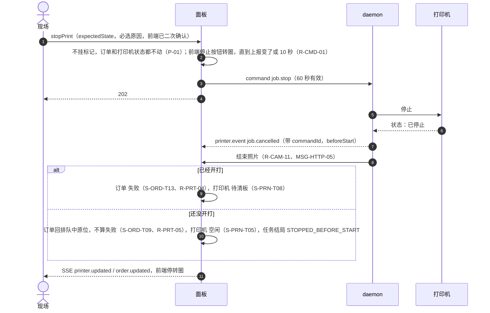

| 步骤 | 失败 | 处理 | 依据 |
| --- | --- | --- | --- |
| 1 | 状态已经变了 | 409 `state_conflict` | API-CONC-02 |
| 3 | daemon 不在线 | 409 `printer_unreachable`，不挂标记 | API-ASYNC-03 |
| 7 | daemon 回 expired / rejected / failed，或打印机还报打印中 / 暂停中这个任务 | 不挂标记、不进待办；停止按钮照常可点，现场人员看摄像头决定要不要再点（新命令）；固件给的失败原因原样显示 | R-CMD-05、Q243 |
| 6 前 | 现场人员改主意 | 停止不能撤销，没有对应接口 | R-PRT-04 |
| 7 | 有人在打印机屏幕上停的（job.cancelled 不带 commandId） | 同样按 beforeStart 走；时间线记"在设备端停止"，现场人员可以用 addDeviceStopNote 补一条备注；照样拍结束照片 | R-CAM-11、Q217 |
| 5 | 任务还在传文件（开打指令没发） | daemon 不碰打印机：中止传输、删掉自己传了一半的文件（INV-15）、先把"这个 jobRef 不再发开打"写进硬盘，再回 job.cancelled（带 commandId，beforeStart=true）→ 走"还没开打"分支。开打指令只有 daemon 发，以它为准 | MSG-CMD-START、Q223 |
| 7 | 打印机在停下之前自己打完了 | 收到 job.finished → 按 SEQ-08 处理 | P-01 |

## SEQ-05 取消订单

只有待审核、排队中的订单能取消（S-ORD-T18、R-CAN-01、R-CAN-02），不涉及打印机：cancelOrder（expectedStatus，必填原因）→ 已取消，未审的版本撤下（R-CAN-05）。

| 失败 | 处理 | 依据 |
| --- | --- | --- |
| 已派单 | 422 `rule_violation`，请现场人员先停止（SEQ-04），回到排队中后再取消 | R-CAN-03、Q207 |
| 打印中、失败、待入库、待取件 | 422 `rule_violation`；失败只能重打，打完的单长期没取走按 R-PCK-05 | R-CAN-04、Q210 |
| 状态已经变了 | 409 `state_conflict` | API-CONC-02 |

## SEQ-06 报错和处理报错

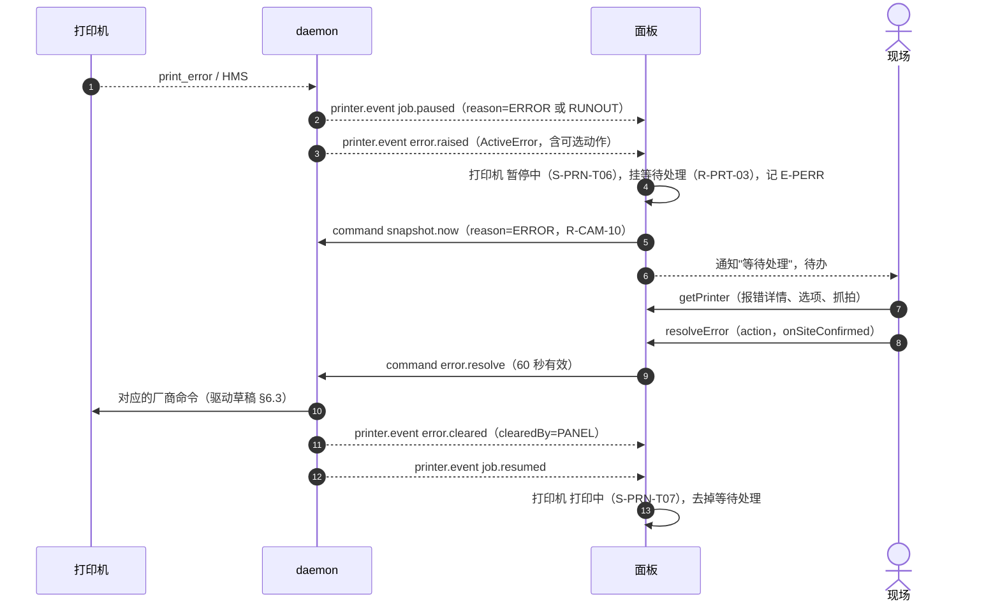

| 步骤 | 失败 | 处理 | 依据 |
| --- | --- | --- | --- |
| 8 | 选的动作不在这条报错的选项里 | 422 | R-PRT-14 |
| 8 | 需要现场处理的选项没确认在现场 | 422 | E-PERR、驱动草稿 §6.5 |
| 8 | 别人已经处理了 | 409 | 驱动草稿 §6.5 |
| 2 | 报错发生在准备阶段（进料失败、堵头、自检，开打前） | 任务 准备中 → 暂停中（paused_from=PREPARING），订单仍是已派单，打印机仍是准备中并挂等待处理；同样走 resolveError；恢复后任务回准备中，真正开打才进打印中。这时停止 → STOPPED_BEFORE_START，订单回原位 | S-JOB、Q240 |
| 10–12 | 10 秒内没看到报错清除 | 前端停转圈，提示看摄像头，由人判断要不要重新选动作（新命令），不自动重发 | R-CMD-01、Q243 |
| 10 | 固件拒绝 | command.result failed，原样显示固件的话 | R-PRT-15 |
| 11 | 有人在打印机屏幕上处理了 | error.cleared clearedBy=DEVICE，记"在设备端处理" | MSG-EVT |
| 12 | 选的是"停止" | 按 job.stop 发，走 SEQ-04；任务结束时这次报错挂的等待处理一并去掉 | R-PRT-04、Q203、Q226 |
| 13 | 暂停太久没人管 | 超过 CFG-PRT-01 提醒；不自动继续、不自动停止 | R-PRT-06 |

人工暂停（reason=USER）不挂等待处理，继续走设备控制 `job.resume`（IF-ADP-05）。

## SEQ-07 断线、重连和对账

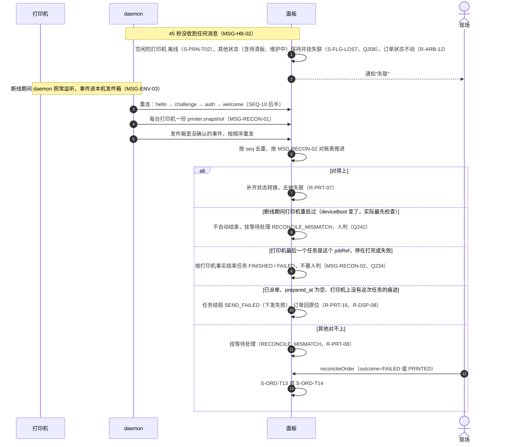

| 步骤 | 失败 | 处理 | 依据 |
| --- | --- | --- | --- |
| 4 | 协议版本不兼容 | 4426 断开，挂"daemon 需要升级" | MSG-VER-02 |
| 4 | daemon 已被吊销 | 4403，不再重连 | MSG-AUTH-05 |
| 7 | 事件缺号 | 等 10 秒，还没来就要快照对账 | MSG-ENV-06 |
| 8 | 只有 daemon 连得上面板、连不上打印机 | connection.down 事件，按同样规则处理那一台 | MSG-HB-03 |
| 7 | 断线时还没送达的命令 | 发件箱按同一 commandId 补投；daemon 按落盘的命令 ID 去重，过期的回 expired，同一条命令最多执行一次 | MSG-ENV-04、R-CMD-08 |
| — | 打印机移到另一个 daemon（updatePrinter 改 daemonId），或 daemon 重装丢了本地清单 | 新 daemon 从 MSG-ASSIGN 拿到 currentJobRef / cleanupJobRefs；打印机上在打的任务或 `pr-<后 12 位>` 文件对得上就认作系统任务，收进自己的清单（之后按 INV-15 照常清理），不当外部任务 | MSG-JOBREF-02、Q228 |

## SEQ-08 打完、铲件入库、核销

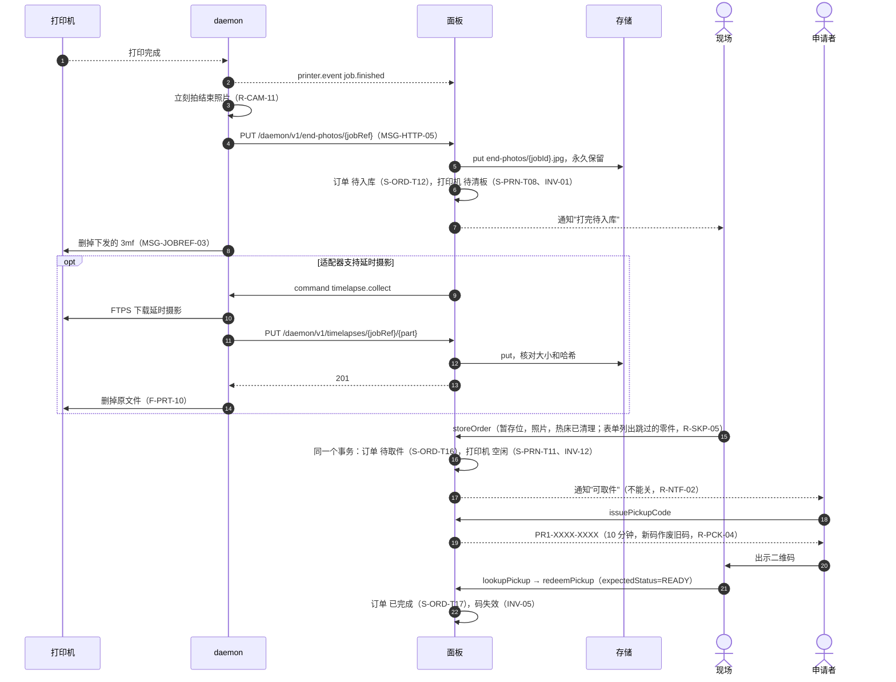

| 步骤 | 失败 | 处理 | 依据 |
| --- | --- | --- | --- |
| 11 | 哈希不对 | 面板不返回 201，daemon 不删原文件，下次重试 | F-PRT-10 |
| 14 | 没勾"热床已清理" / 没照片 | 422 | R-PCK-01 |
| 14 前 | 打印机进待清板超过 CFG-PRT-04（默认 10 分钟）还没入库或清板 | 提醒现场人员，之后每隔 CFG-PRT-04 再提醒，直到清板 | R-PRT-21、Q241 |
| 18 | 码过期、作废、不存在 | 404，申请者重新签发 | R-PCK-03 |
| 19 | 两个现场人员同时扫 | 后到的 409 `state_conflict` | INV-05 |
| 15 后 | 长期没人取 | 每 CFG-PCK-02 提醒；管理员可以 disposeOrder（S-ORD-T21） | R-PCK-05 |

打印机上没有待入库成品时（如外部任务打完），现场人员用 confirmBedCleared 直接放行（S-PRN-T11、R-PCK-02）。

## SEQ-09 失败后重打

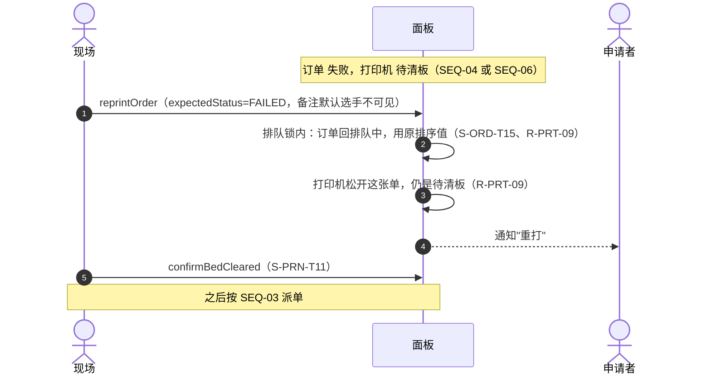

| 步骤 | 失败 | 处理 | 依据 |
| --- | --- | --- | --- |
| 1 | 文件已过保留期 | 按钮置灰，410 `file_expired`；请申请者重新提交 | R-PRT-10、R-ARB-03 |
| 1 | 订单归档过 | 按钮置灰，422 `rule_violation` | R-PRT-09、R-ARC-02 |
| 1 | 已被标为不重打 | 重打按钮隐藏，422 `rule_violation`；管理员 revokeReprintDecline 后恢复 | R-PRT-18、R-PRT-19 |
| 1 | 不是失败状态 | 409 `state_conflict` | API-CONC-02 |

版本、文件、修改次数都不变（R-VER-11）。申请者没有重打按钮（F-PRT-07）。

重打只用于打印机或现场一方的问题。选手模型本身的问题，现场人员改用 declineReprint（不重打，请选手重新提交，必须填原因，默认选手可见）：订单仍是失败，移出待办，申请者收到通知后自己提交新订单（R-PRT-18，Q224）。

## SEQ-10 daemon 安装注册和连接认证

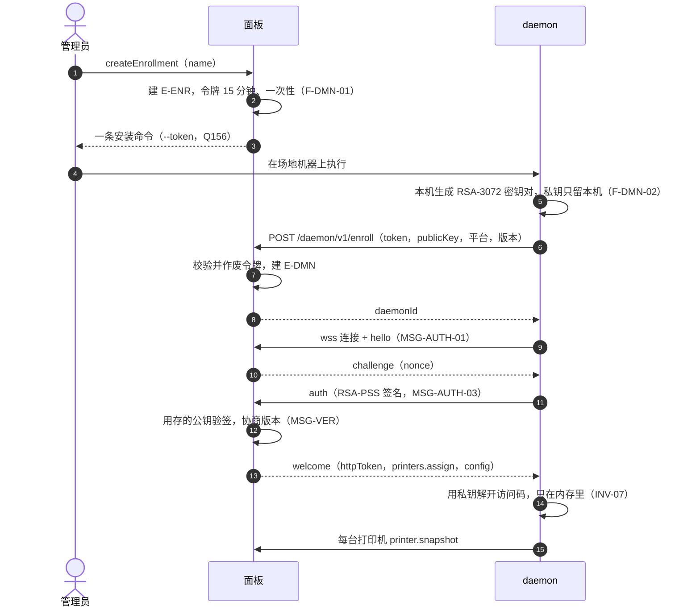

| 步骤 | 失败 | 处理 | 依据 |
| --- | --- | --- | --- |
| 7 | 令牌过期 | 401，管理员重新生成 | F-DMN-01 |
| 7 | 令牌已被使用 | 401，脚本提示管理员去 daemon 列表查有没有陌生的注册 | MSG-ENR、Q156 |
| 12 | 签名不对 | 4401 断开 | MSG-AUTH-05 |
| 12 | 同一个 daemon 又连了一条 | 新的顶掉旧的，旧的收到 4409。10 分钟内被不同 IP 顶掉 3 次及以上 → 通知管理员"疑似私钥泄露，请检查并吊销"，不自动吊销 | MSG-AUTH-05、R-OPS-02 |
| 14 | 访问码是用旧公钥加密的 | connection.down（access_code_key_mismatch），面板提示重填 | MSG-ASSIGN |

添加打印机：管理员在 getDaemonPublicKey 拿公钥，浏览器加密访问码，createPrinter（INV-07、F-PRT-12）；面板发新的 printers.assign。

## SEQ-11 看实况

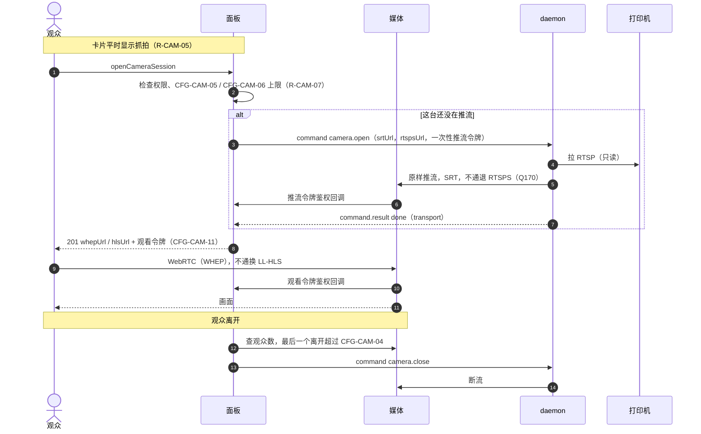

| 步骤 | 失败 | 处理 | 依据 |
| --- | --- | --- | --- |
| 2 | 访客且 CFG-CAM-01 关 / 机型不支持 | 409 `stream_unavailable`，看抓拍 | R-CAM-02 |
| 2 | 到上限 | 409 `camera_limit`，看抓拍 | R-CAM-07 |
| 7 | 拉流失败 | command.result failed `stream_unavailable` → 观众看抓拍 | MSG-MEDIA-07 |
| 10 | 浏览器 WebRTC 不通 | "自动"时换 LL-HLS | CFG-CAM-11 |

JPEG 帧机型（P1、A1）把步骤 5–8 换成 daemon 的 `wss .../frames/{printerId}`，面板用 WebSocket 转给浏览器（MSG-MEDIA-03）。抓拍的频率和错峰见 MSG-SNAP。

## SEQ-12 归档本期

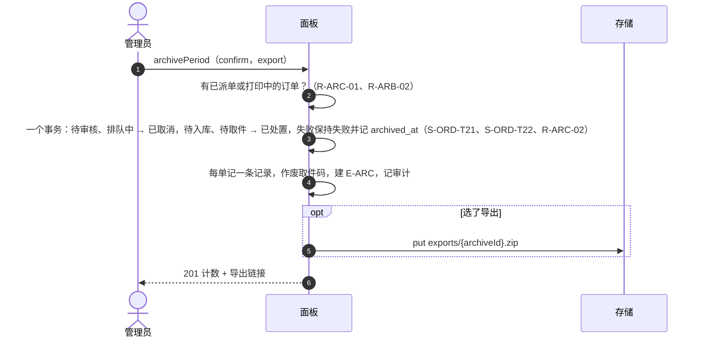

| 步骤 | 失败 | 处理 | 依据 |
| --- | --- | --- | --- |
| 2 | 还有已派单或打印中的 | 422 `rule_violation`（R-ARC-01），列出是哪些单 | R-ARC-01 |
| 5 | 导出失败 | 归档照常完成，导出可以单独重试 | F-OPS-04 |

订单编号不重置（E-ORD），审计日志不受影响（INV-06）。
