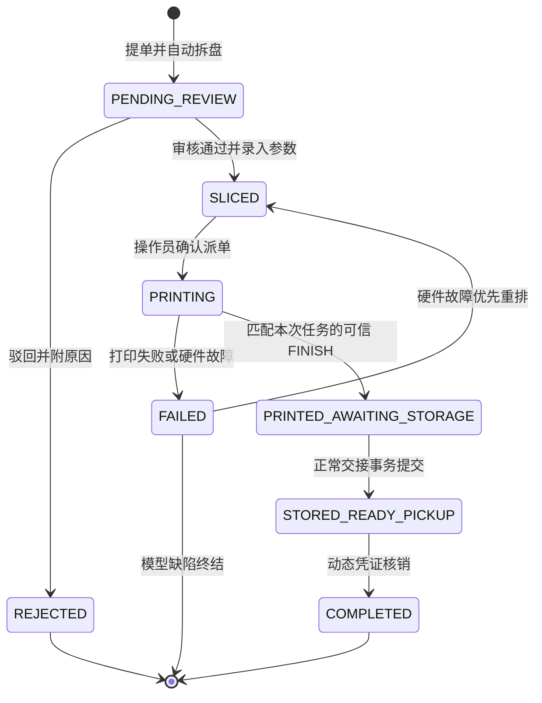
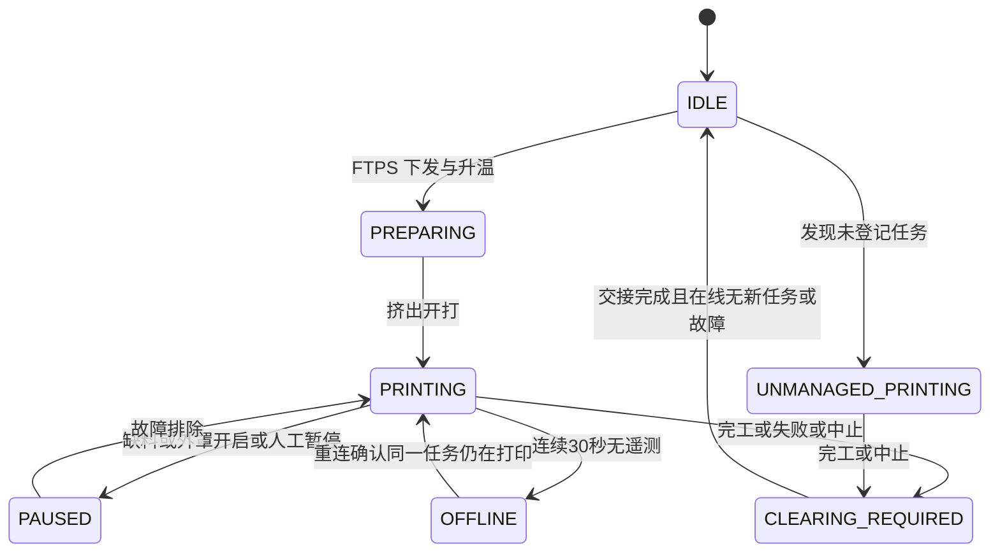

# PlateRelay 领域规范

本文件保留赛事共享 3D 打印服务的目标业务契约；未实现内容不是当前能力声明。阶段状态见 [ROADMAP](../ROADMAP.md)，技术边界见 [架构](architecture.md)，字段与约束见 [数据模型](data-model.md)。涉及冲突的规则必须连同[实施前待决](#实施前待决)阅读，不得只取其中一条实现。

## 身份与权限

系统按自然人 `submitter` 管理提单，不感知外部队伍。原生账号密码登录为主，OAuth/OIDC 为扩展；`OAuthProvider` 只提取 `sub` / `external_id`、`display_name`、邮箱/手机号与资格断言（如 `is_participant: true`），丢弃 Team、Track、分组等组织字段。`users` 与 `user_oauth_bindings` 独立绑定，原始 claims 的存储也不得绕过防腐边界。

| 角色 | 能力 | 边界 |
| --- | --- | --- |
| `submitter` | `job:submit`, `job:view_own`, `job:cancel_own` | 仅管理本人工单、查看本人凭证。 |
| `operator` | `job:review`, `job:dispatch`, `job:abort`, `printer:operate`, `storage:manage`, `storage:checkout` | 审核、派单、机台维护、清台、仓储核销。 |
| `admin` | `*`，含 `system:config`, `user:manage` | 全局配置、用户、机台注册和耗材主档。 |

API 采用无状态 RESTful / Bearer JWT 设计，不耦合服务端 Session/Cookie；与内部 WS 预共享凭证的适用边界见待决项。

## 提单与并发

- 只接受 BambuStudio / OrcaSlicer 生成且含合法 `Metadata/slice_info.config` 的 `.gcode.3mf`。一个工程有 N 个盘时拆成 N 张独立子工单，共享 `batch_sn`，各有 `job_sn`、生命周期、审批和排期；内存解包规则见 [对象存储](architecture.md#对象存储)。
- 盘级审核：合格盘转 `SLICED`，不合格盘转 `REJECTED` 并附原因/修改建议。审核后默认按 `approved_at` FIFO 排队，操作员可拖拽调序或置顶。
- 提单前原子校验动态配置 `system_settings.max_active_jobs_per_user`，赛事默认 1，可由管理员按负荷调整（如 2）；超限返回 HTTP 400，不得硬编码 `count >= 1`。
- 正常工单在 `PENDING_REVIEW` / `SLICED` / `PRINTING` / `PRINTED_AWAITING_STORAGE` 期间持有额度；节点 A 在正常交接事务将其转为 `STORED_READY_PICKUP` 时释放。完工、打开弹窗或只确认清台均不提前释放；故障重排豁免及多盘提单的限额边界仍见待决项。
- 名下 `STORED_READY_PICKUP` 数达到 `system_settings.max_uncollected_jobs_per_user`（默认 2）时暂停提单，须先取件核销。

## 工单状态机

- **硬件匹配**：派单必须同时校验切片目标机型、热床尺寸、喷嘴口径与机台一致；不得只比较 `jobs.target_printer_model == printers.model`。
- **原子回滚**：操作员确认后，FTPS 上传超过 60 秒、MQTT 下发 10 秒内未响应，或任一步骤异常时，必须捕获异常并原子恢复工单 `SLICED`、机台 `IDLE`，保留队列原位。跨模块事务方案见 [架构待决项](architecture.md#实施前待决)。
- **失败归因**：喷嘴堵塞、热床断电、断料等机房/硬件原因，可一键转派、重置 `SLICED` 并插入队首，不占提交者并发额度；模型悬垂/壁厚/切片缺陷则终结，释放额度，附失败照片通知修改后重排。额度例外的表达尚待裁决。
- **完工抓拍**：匹配本工单物理任务的 MQTT `FINISH` 到达时，立即异步调用 go2rtc 保存 `finish_snapshot_url`，超时 ≤3 秒；失败记录警告及缺失，不阻塞待清台/待入库。打开交接界面展示已保存底片，缺失时可重试，但后拍照片不得冒充原始完工瞬间的底片。
- **入库与清台**：执行下方[物理清台与仓储交接](#物理清台与仓储交接)，不能以百分比 100%、设备自身 `IDLE` 遥测或勾选动作代替已完成的交接。

## 机台状态机

工单生命周期与机台物理状态分开管理，禁止以网络状态代替工单结果。

- 可信终态到达后锁定该次物理任务的清台事实；100% 仅为进度展示，不推导成功。在线时显示黄色 `CLEARING_REQUIRED`；断网显示 `OFFLINE`，但清台锁不能丢失。正常成品完成入库交接、异常任务完成异常清台之前均禁止派单；机台自己报告 `IDLE` 不能解除该锁。
- 进入 `CLEARING_REQUIRED` 或恢复 `IDLE` 后，后台异步通过 FTPS 删除机身 SD 卡上**本次任务对应**的完工 `.gcode.3mf`；不得将“清理 `/` 缓存”解释为删除无关文件。监控阶段不执行此写操作。
- 连续 30 秒无 MQTT 遥测标记 `OFFLINE`，不能将正在打印的工单判为失败；指数退避重连，恢复后以真实遥测校正物理状态，不盲目假定仍为 `PRINTING`。
- SD 卡或 Bambu Studio 直发的未登记任务进入 `UNMANAGED_PRINTING`，高亮告警，记录实际时长/层数并标为“耗材待核对”。完工后仍须清台；操作员确认/录入耗材消耗，无切片元数据时禁止自动盲扣。

## 仓储与履约

`FulfillmentAdapter` 隔离交付方式，赛事目标实现为 `LockerFulfillment`。一张子盘工单对应一份完整交接物料、一个实体盒或一个唯一溢出袋；同盘多件放在同一份中，不拆多个位置，不混放不同工单。

- 实体盒（如 `BIN-A01`～`BIN-A40`）遵循 `FREE` → `RESERVED` → `OCCUPIED`；提交交接前只能视为预占，不能显示已入库。仅建议库位不占用资源。
- 实体盒无空位时建议 `BIN-OVERFLOW` 区域，必须生成并粘贴唯一可扫描的袋码。区域可容纳多份独立袋，不能用共享池名代替袋身份，也不能对整池加一把独占锁。无袋或无安全放置条件时不得虚构入库。
- 入库提交只开放取件资格。提交者打开取件页时由后端签发默认 10 分钟、时效可配置的 Bearer QR，前端倒计时/静默刷新并渲染；载荷包含 `job_id`、`salt`、`exp`。允许转交同伴代领，签名密钥不得下放浏览器；签发或通知失败不回滚已完成的入库。
- 核验照片并交付对应完整物料后，必须确认实体盒已完全清空，才在同一事务中核销工单、释放该盒为 `FREE` 并结束其交接占用。溢出袋核销只结束该唯一袋的占用，不释放/封锁其他袋或整个池。
- **未来扩展，不属于当前赛事交付**：`FarmStagingFulfillment` 保留质检、打包、成品暂存、扫码交付的厂内流程设想；`LogisticsFulfillment` 保留外部物流扩展点。当前不得实现农场流程或引入顺丰/菜鸟等物流 SDK。

## 物理清台与仓储交接

本节为已确认的目标契约，不表示 M1 已实现仓储。工单状态仍使用 `STORED_READY_PICKUP`，不增加同义 `READY_FOR_PICKUP`。

### 正常成品交接

| 步骤 | 门禁与结果 |
| --- | --- |
| 识别完工 | 终态必须匹配机台、本次物理任务及工单，区分成功、失败和中止；旧任务或重复消息不能关闭/覆盖新任务。正常成功后工单进入待入库，机台保持清台锁。 |
| 进入办理 | 桌面卡片显示“去清台入库”；手机扫机身码定位同一流程。必须登录并具有 `printer:operate` 与 `storage:manage` 能力；静态机身码不授予权限，提交者不能自助放行。 |
| 单人领取办理权 | 服务端为本次物理任务持久化一条进行中的交接，绑定办理人及版本；第二设备可查看，不另开一份可提交交接。 |
| 选择并预占 | 打开界面只建议位置；选定确认后原子预占实体盒或绑定唯一溢出袋，成功前不提示放件。已被其他交接占用时重新选位，不能先混放再靠提交冲突补救。 |
| 物理核对与放件 | 通过手机相机/扫码枪读取实际盒/袋码并匹配预占目标，扫错禁止提交。操作员将本盘完整物料放入对应位置，保存现场入库照。 |
| 清台声明 | 操作员本人勾选“目视确认热床已清空且无残渣”，默认不勾选；扫码、照片上传或关闭窗口都不能自动勾选。该声明不是系统自动识别热床干净的证明。 |
| 提交 | 服务端重新核验办理权/版本、任务、工单状态、位置、扫码证据、已保存的入库照和清台声明；按[交接事务](architecture.md#交接事务)原子提交。未提交成功不向提交者展示可取件。 |

完工底片允许缺失，**入库现场照片必须成功保存**；仅有手机本地照片、正在上传或失败的对象地址都不满足门禁。拍照/上传在事务外进行，照片与当前交接关联，不能借用其他工单的资产。

### 恢复与应急

- 弹窗关闭、超时、断网、Panel 重启不自动释放已允许放件的预占，也不解除清台锁。恢复时读取原持久化交接，而不是新建一份；照片上传或提交失败后仍显示未完成。
- 取消前须由办理人明确确认“尚未放入物料，或已经全部取回”，原子释放其预占并记录原因；完成入库后的取消不走此入口。物理去向未知时保留保护，交由现场核查，不用超时任务猜测盒内为空。
- 其他有办理能力的操作员可显式接管，记录原/新办理人、时间、原因并推进版本；旧页面立即失去写入权，接管不重新分配位置或抹掉已有证据。
- 重复提交返回已保存结果，不重复占位、转状态、释放额度或新增完成审计。成功响应丢失时先查询本交接结果；不能仅因页面超时撤销真实交接。
- 机台断网不阻塞正常入库，但仍为 `OFFLINE`、禁止派单。只保存本次任务的清台事实；若已发现新任务/故障，不能将旧任务的清台声明移用为新任务的放行依据，也不能强写 `IDLE`。
- 扫码设备故障时，仅管理员可显式改用人工核对：填写实际目标码和原因，记录其身份及核对方式。此例外不跳过预占独占、任务一致性、已保存入库照和本人清台声明，也不伪造扫描记录。

### 异常清台

失败、中止和野生任务使用同一办理权/接管/幂等保护，但走独立异常分支：本人确认物料已移出热床且无残渣、填写实际处置结果；野生任务还必须由操作员确认/录入耗材核对结果。记录人、时间与物理任务后，只解除该次任务的清台锁。

异常分支不强制占用成品库位或套用正常入库照门禁，不把 `FAILED` 改成成功，不生成取件 QR，不自动释放属于故障归因/重排流程的额度，也不为无主物料伪造提交者。机台可接单仍要求在线、没有新任务/故障且所有相关清台锁已解除；失败照片通知与故障归因规则不因此取消。

## 耗材与成本

- 监听 MQTT `ams.tray`，自动建档/更新 `printer_spool_slots`。解包时将各 AMS 槽（0～3）及外挂槽（-1）的预估克数写入 `job_spool_usages`。
- 派单开打 `PRINTING` 时锁定机台并冻结关联料盘的预估克数；正常 `FINISH` 时解冻，按切片克数扣减 `spools.current_weight_g`，包括模型、冲刷擦料塔和吐丝。
- 失败扣减保留原设计公式；`mc_percent` 量纲及零总层数处理未明确，裁决前不能直接照抄执行：

$$\text{ActualDeduction}_{i} = \text{EstimatedGrams}_{i} \times \max\left(\text{mc\_percent}, \frac{\text{layer\_num}}{\text{total\_layer\_num}}\right)$$

- 单件料电成本设计如下；每克单价与数据模型字段的换算尚待明确，电价必须从 `system_settings` 动态读取：

$$\text{Cost}_{\text{total}} = \sum (\text{ActualWeight}_{i} \times \text{UnitPricePerGram}_{i}) + \left(\frac{\text{Duration}_{\text{sec}}}{3600} \times \frac{\text{RatedPower}_{\text{W}}}{1000} \times \text{ElectricityPrice}_{\text{kWh}}\right)$$

不扩展销售利润率、发票核销、客户账期或税务逻辑。耗材领域的具体模块与交付切片尚未划定，不能因路线图未单列就删除该需求。

## 资产与审计

| 业务节点 | 归档资产 |
| --- | --- |
| 提单 | 原始 `.gcode.3mf` 与 `Metadata/plate_*.png` 盘预览图 |
| 完工 | `finish_snapshot.jpg`，对应完工抓拍 |
| 入库 | `storage_photo.jpg`，对应储物篮/收纳袋中的实物 |

`job_artifacts` 保存对象存储 Key、类型、大小及上传者；工单审计记录操作人 ID/名称快照、动作、前后状态、客户端类型、上下文与时间。审计不可变要求与删除级联关系见 [数据模型](data-model.md#实施前待决)。

## 领域事件

跨模块通信规则见 [模块与事务](architecture.md#模块与事务)。事件是目标契约，不表示已有实现；交接状态变更由显式事务完成，提交后事件只用于广播/通知等后续工作，不以多个回调拼接原子性。

| 事件 | 对应节点 |
| --- | --- |
| `UserSubmitted3MFEvent` | 提单解包与拆盘 |
| `JobApprovedEvent` | 审核通过并进入待排队列 |
| `JobDispatchFailedEvent` | 派单原子回滚 |
| `PrinterJobFinishedEvent` | 完工抓拍与待入库 |
| `PrinterTelemetryLostEvent` | 30 秒遥测丢失、机台离线但不判工单失败 |
| `JobStoredEvent` | 正常交接事务已提交，入库、清台事实与节点 A 解锁已落库 |
| `JobPickedUpEvent` | 核销、防呆确认及库位释放 |

## 实施前待决

以下问题没有在本次重构中裁定；相关切片开始前必须由用户确认，不能靠文档优先级或实现便利性选边。

| 问题 | 保留的要求与待确认事项 |
| --- | --- |
| 故障重排与多盘限额 | 正常成功工单持有额度至入库已确认；硬件故障重排回 `SLICED` 的豁免表达、多盘同时提单如何受限仍待裁决。“每人限额”不能证明可识别多账号同组抢占。 |
| 鉴权范围 | 原“全接口 RESTful + Bearer JWT、禁 Session/Cookie”与内部 WS + 预共享 Token 并存。需明确业务 API、浏览器 WS、内部节点协议的适用范围。 |
| 耗材量纲 | `mc_percent` 是 0～1 还是 0～100、总层数为 0 时如何计算、`unit_price_cny` 是每克还是每卷价格，以及换算规则均待明确；保留公式不等于公式已可执行。 |

跨模块事务、本地文件禁令、模块归属见 [架构待决项](architecture.md#实施前待决)；审计保留及 DDL 落地边界见 [数据模型待决项](data-model.md#实施前待决)。
