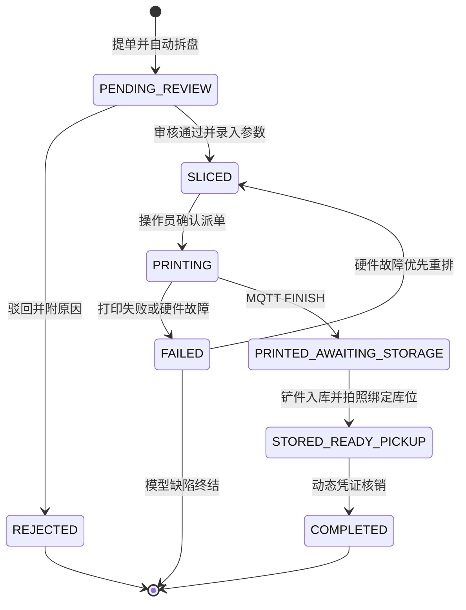
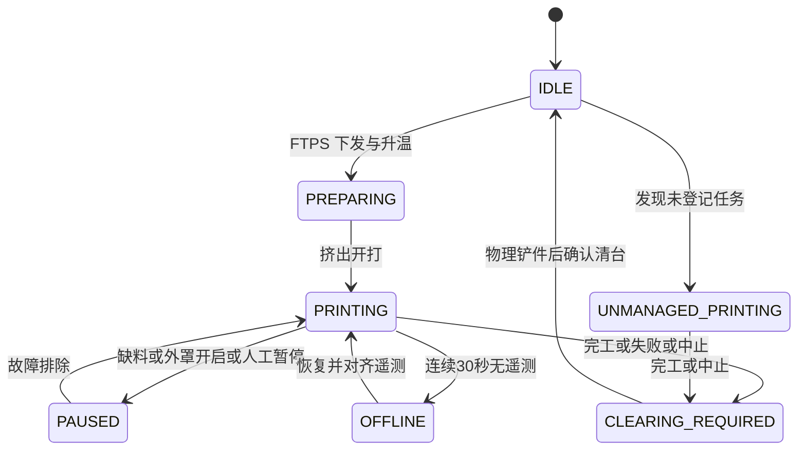

# PlateRelay 领域规范

本文件保留赛事共享 3D 打印服务的目标业务契约；未实现内容不是当前能力声明。阶段状态见 [ROADMAP](../ROADMAP.md)，技术边界见 [架构](architecture.md)，字段与约束见 [数据模型](data-model.md)。涉及冲突的规则必须连同[实施前待决](#实施前待决)阅读，不得只取其中一条实现。

## 身份与权限

系统按自然人 `submitter` 管理提单，不感知外部队伍。原生账号密码登录为主，OAuth/OIDC 为扩展；`OAuthProvider` 只提取 `sub` / `external_id`、`display_name`、邮箱/手机号与资格断言（如 `is_participant: true`），丢弃 Team、Track、分组等组织字段。`users` 与 `user_oauth_bindings` 独立绑定，原始 claims 的存储也不得绕过防腐边界。

| 角色 | 能力 | 边界 |
| --- | --- | --- |
| `submitter` | `job:submit`, `job:view_own`, `job:cancel_own` | 仅管理本人工单、查看本人凭证。 |
| `operator` | `job:review`, `job:dispatch`, `job:abort`, `printer:operate`, `storage:manage`, `storage:checkout` | 审核、派单、机台维护、清台、仓储核销。 |
| `admin` | `*`，含 `system:config`, `user:manage` | 全局配置、用户、机台注册和耗材主档。 |

API 采用无状态 RESTful / Bearer JWT 设计，不耦合服务端 Session/Cookie；与内部 WS 预共享凭证的适用边界见待决项。

## 提单与并发

- 只接受 BambuStudio / OrcaSlicer 生成且含合法 `Metadata/slice_info.config` 的 `.gcode.3mf`。一个工程有 N 个盘时拆成 N 张独立子工单，共享 `batch_sn`，各有 `job_sn`、生命周期、审批和排期；内存解包规则见 [对象存储](architecture.md#对象存储)。
- 盘级审核：合格盘转 `SLICED`，不合格盘转 `REJECTED` 并附原因/修改建议。审核后默认按 `approved_at` FIFO 排队，操作员可拖拽调序或置顶。
- 提单前原子校验动态配置 `system_settings.max_active_jobs_per_user`，赛事默认 1，可由管理员按负荷调整（如 2）；超限返回 HTTP 400，不得硬编码 `count >= 1`。
- 原活跃计数集合为 `PENDING_REVIEW` / `SLICED` / `PRINTING`；另有“节点 A：完成入库至 `STORED_READY_PICKUP` 才释放下一盘权限”要求。二者及硬件故障重排豁免存在冲突，必须先裁决，不能按该集合直接提前解锁。
- 名下 `STORED_READY_PICKUP` 数达到 `system_settings.max_uncollected_jobs_per_user`（默认 2）时暂停提单，须先取件核销。

## 工单状态机

- **硬件匹配**：派单必须同时校验切片目标机型、热床尺寸、喷嘴口径与机台一致；不得只比较 `jobs.target_printer_model == printers.model`。
- **原子回滚**：操作员确认后，FTPS 上传超过 60 秒、MQTT 下发 10 秒内未响应，或任一步骤异常时，必须捕获异常并原子恢复工单 `SLICED`、机台 `IDLE`，保留队列原位。跨模块事务方案见 [架构待决项](architecture.md#实施前待决)。
- **失败归因**：喷嘴堵塞、热床断电、断料等机房/硬件原因，可一键转派、重置 `SLICED` 并插入队首，不占提交者并发额度；模型悬垂/壁厚/切片缺陷则终结，释放额度，附失败照片通知修改后重排。额度例外的表达尚待裁决。
- **完工抓拍**：MQTT `FINISH` 时异步调用 go2rtc 写入 `finish_snapshot_url`，超时 ≤3 秒；失败只记录警告，不阻塞转入 `PRINTED_AWAITING_STORAGE`。
- **入库**：志愿者铲件，拍实物照片 `storage_photo_url`，绑定实体库位或溢出暂存袋；这是节点 A 的解锁时点，不能用“打印完工”等同“已入库”。

## 机台状态机

工单生命周期与机台物理状态分开管理，禁止以网络状态代替工单结果。

- 任务结束或失败后强制 `CLEARING_REQUIRED`；志愿者完成物理铲件并在界面清台打卡前，不接收新派单。
- 进入 `CLEARING_REQUIRED` 或恢复 `IDLE` 后，后台异步通过 FTPS 删除机身 SD 卡上**本次任务对应**的完工 `.gcode.3mf`；不得将“清理 `/` 缓存”解释为删除无关文件。监控阶段不执行此写操作。
- 连续 30 秒无 MQTT 遥测标记 `OFFLINE`，不能将正在打印的工单判为失败；指数退避重连，恢复后以真实遥测校正物理状态，不盲目假定仍为 `PRINTING`。
- SD 卡或 Bambu Studio 直发的未登记任务进入 `UNMANAGED_PRINTING`，高亮告警，记录实际时长/层数并标为“耗材待核对”。完工后仍须清台；操作员确认/录入耗材消耗，无切片元数据时禁止自动盲扣。

## 仓储与履约

`FulfillmentAdapter` 隔离交付方式；当前只实现赛事 `LockerFulfillment`。实体库位 `storage_bins`（如 `BIN-A01`～`BIN-A40`）入库时原子独占：`FREE` → `OCCUPIED`。

- 实体库位全满时允许 `BIN-OVERFLOW` 虚拟溢出暂存池。操作员将条码标签打印粘贴到收纳袋并入库，避免库位不足阻塞清台与机台回到 `IDLE`。
- 取件使用可转交同伴代领的 Bearer QR。载荷包含 `job_id`、`salt`、`exp`，默认 `exp = now + 10min`，时效后台可配；领料页面倒计时、静默刷新并渲染二维码，领料台扫码枪核销。
- 核验照片、交付物料后，界面强制提示“请目视确认储物盒 [BIN-xxx] 内部已完全清空”。操作员确认后，才在同一事务中核销工单并将库位释放为 `FREE`。
- **未来扩展，不属于当前赛事交付**：`FarmStagingFulfillment` 保留质检、打包、成品暂存、扫码交付的厂内流程设想；`LogisticsFulfillment` 保留外部物流扩展点。当前不得实现农场流程或引入顺丰/菜鸟等物流 SDK。

## 耗材与成本

- 监听 MQTT `ams.tray`，自动建档/更新 `printer_spool_slots`。解包时将各 AMS 槽（0～3）及外挂槽（-1）的预估克数写入 `job_spool_usages`。
- 派单开打 `PRINTING` 时锁定机台并冻结关联料盘的预估克数；正常 `FINISH` 时解冻，按切片克数扣减 `spools.current_weight_g`，包括模型、冲刷擦料塔和吐丝。
- 失败扣减保留原设计公式；`mc_percent` 量纲及零总层数处理未明确，裁决前不能直接照抄执行：

$$\text{ActualDeduction}_{i} = \text{EstimatedGrams}_{i} \times \max\left(\text{mc\_percent}, \frac{\text{layer\_num}}{\text{total\_layer\_num}}\right)$$

- 单件料电成本设计如下；每克单价与数据模型字段的换算尚待明确，电价必须从 `system_settings` 动态读取：

$$\text{Cost}_{\text{total}} = \sum (\text{ActualWeight}_{i} \times \text{UnitPricePerGram}_{i}) + \left(\frac{\text{Duration}_{\text{sec}}}{3600} \times \frac{\text{RatedPower}_{\text{W}}}{1000} \times \text{ElectricityPrice}_{\text{kWh}}\right)$$

不扩展销售利润率、发票核销、客户账期或税务逻辑。耗材领域的具体模块与交付切片尚未划定，不能因路线图未单列就删除该需求。

## 资产与审计

| 业务节点 | 归档资产 |
| --- | --- |
| 提单 | 原始 `.gcode.3mf` 与 `Metadata/plate_*.png` 盘预览图 |
| 完工 | `finish_snapshot.jpg`，对应完工抓拍 |
| 入库 | `storage_photo.jpg`，对应储物篮/收纳袋中的实物 |

`job_artifacts` 保存对象存储 Key、类型、大小及上传者；工单审计记录操作人 ID/名称快照、动作、前后状态、客户端类型、上下文与时间。审计不可变要求与删除级联关系见 [数据模型](data-model.md#实施前待决)。

## 领域事件

跨模块通信规则见 [模块与事务](architecture.md#模块与事务)。事件是目标契约，不表示已有实现；具体行为以本文件对应规则为唯一依据。

| 事件 | 对应节点 |
| --- | --- |
| `UserSubmitted3MFEvent` | 提单解包与拆盘 |
| `JobApprovedEvent` | 审核通过并进入待排队列 |
| `JobDispatchFailedEvent` | 派单原子回滚 |
| `PrinterJobFinishedEvent` | 完工抓拍与待入库 |
| `PrinterTelemetryLostEvent` | 30 秒遥测丢失、机台离线但不判工单失败 |
| `JobStoredEvent` | 入库拍照、库位绑定与节点 A 解锁 |
| `JobPickedUpEvent` | 核销、防呆确认及库位释放 |

## 实施前待决

以下问题没有在本次重构中裁定；相关切片开始前必须由用户确认，不能靠文档优先级或实现便利性选边。

| 问题 | 保留的要求与待确认事项 |
| --- | --- |
| 并发计数与节点 A | 活跃集合未含 `PRINTED_AWAITING_STORAGE`，但要求入库才解锁；硬件故障重排回 `SLICED` 又豁免额度。需明确计数、独立锁及豁免如何表达，多盘提交如何受限；“每人限额”本身也不能证明可识别多账号同组抢占。 |
| 取件凭证签发 | 旧稿称“前端轻量签名 Token”，模块职责又指定后端 storage 签发。前端渲染与代领语义保留；签发方、签名密钥归属必须在实现前明确，不得据措辞把密钥下放浏览器。 |
| 鉴权范围 | 原“全接口 RESTful + Bearer JWT、禁 Session/Cookie”与内部 WS + 预共享 Token 并存。需明确业务 API、浏览器 WS、内部节点协议的适用范围。 |
| 耗材量纲 | `mc_percent` 是 0～1 还是 0～100、总层数为 0 时如何计算、`unit_price_cny` 是每克还是每卷价格，以及换算规则均待明确；保留公式不等于公式已可执行。 |

跨模块事务、本地文件禁令、模块归属见 [架构待决项](architecture.md#实施前待决)；审计保留及 DDL 落地边界见 [数据模型待决项](data-model.md#实施前待决)。
