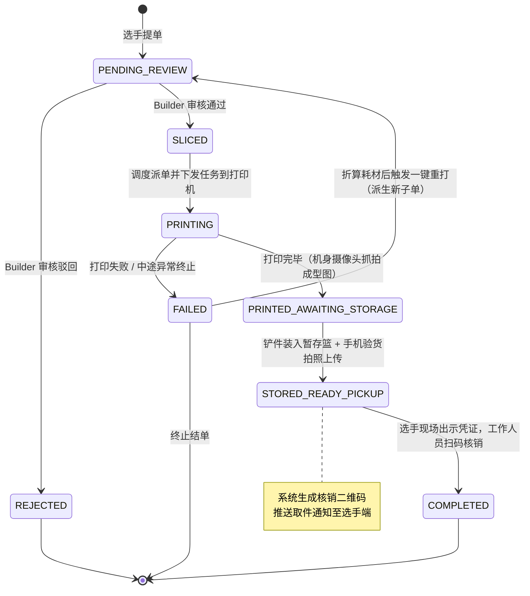
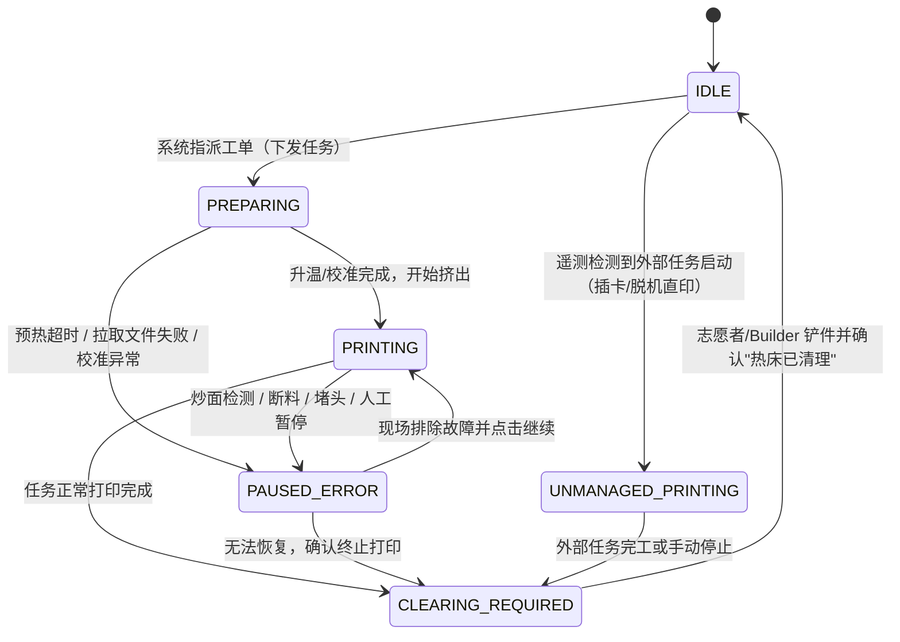

# 公共资源场景 3D 打印管理系统 · 项目简报

> **用途**：浓缩此前一场对话里关于该项目的全部要点，用于在新对话中继续详细讨论。
>
> **标注说明**
> - **【已定】** 用户明确说过的事实或决定
> - **【暂定】** 用户暂时拍板，之后可能调整
> - **【倾向】** 用户正在考虑、尚未最终拍板
> - **【建议】** Claude 提出、用户尚未确认
> - **【待定】** 开放问题
>
> **项目名：PlateRelay。** 本简报后文与 §0 冲突时，以 §0 为准。

---

## 0. 最新决定与第一阶段（MVP）范围

### 0.1 开发方式【已定】

先做 MVP，再往后迭代。第一阶段只做跑通核心流程必需的部分。

### 0.2 新确认的决定【已定】

| 决定 | 影响 |
|---|---|
| **铲件后直接入库，由同一个人完成** | 状态机的耦合点就此定下（见下方说明），开放问题 2 关闭 |
| **只提交 `.gcode.3mf`，用它就能预览模型**，不另附原始模型 | 开放问题 3 关闭 |
| **审核不需要修改模型**：审核只有通过或驳回 | 不加 `NEEDS_REVISION` 状态（撤回 §6.3 里 Claude 的这条建议）；驳回后选手重新提单 |
| **RBAC 是本项目要做的**，但第一阶段不全部上；**至少把 User、Staff、Builder、Coreteam 四个角色分开** | 开放问题 4 关闭 |
| **第一阶段不做机审** | 提交时的自动初筛、G-code 安全扫描都推到后续阶段 |
| **延时摄影放 OSS，存储后端可以是本地，也可以是远端**，以保证兼容性 | 开放问题 10 部分关闭（存储位置已定） |
| 多喷嘴机器要支持；一单一盘，多盘自动拆成独立订单；不做父子订单 | 见 §5.3 |

**"铲件即入库"对两台状态机的影响**【建议】：同一个人、同一次操作（铲件、放进暂存篮、拍照、确认热床已清理），在系统里就是**一个动作**，同时完成两个转移：
- 订单：`PRINTED_AWAITING_STORAGE → STORED_READY_PICKUP`
- 打印机：`CLEARING_REQUIRED → IDLE`

两个转移在同一个事务里完成，不会出现"打印机放行了但成品没入库"或反过来的情况。操作界面上就是一个"铲件入库"按钮，填暂存篮格位、上传照片、勾选"热床已清理"，提交即完成。

### 0.3 四个角色的职责草案【建议，待确认】

| 角色 | 是谁 | 第一阶段能做的事 |
|---|---|---|
| **User** | 选手 | 提交 `.gcode.3mf`、查看自己的订单与队列位置、取消自己尚未开始打印的订单、出示取件码 |
| **Staff** | 现场志愿者 | 铲件入库、扫码核销、处理一般的打印机报错（确认、继续）；【已定】**也能停止打印**，停止时要选失败原因 |
| **Builder** | 打印负责人 | 全部权限：Staff 的全部权限，加上审核、停止打印、失败归因、打印机上下线与维护、用户与角色管理、策略配置、查看审计日志 |
| **Coreteam** | 赛事核心组 | 【已定】与 Builder 权限相同 |

Builder 和 Coreteam 权限完全一样，但仍然保留为两个角色：身份上能区分（审计日志里看得出是谁），以后想让两者的权限分开，改一下种子配置就行。

代码里的权限检查仍然按权限节点来做，四个角色只是预置的节点组合，第一阶段不做角色编辑界面。这样以后加角色、调权限都不用改业务代码。

### 0.4 关于"不做机审"的一点提醒【建议】

建议把"机审"和"格式校验"分开：
- **机审**（推后）：自动判断模型能不能打、G-code 里有没有危险参数、要不要直接拦掉；
- **格式校验**（第一阶段仍然需要）：文件是不是合法的 `.gcode.3mf`、大小是否超限、有几个打印板、目标机型有没有可用的打印机。这几项是**自动拆单、预览、派单本身就要用到的解析**，不做的话后面的流程走不通。

第一阶段没有机审，意味着**所有安全把关都落在 Builder 人工审核上**，审核界面最好把解析出的机型、喷嘴、材质、预估时长和耗材都直接展示出来，方便人工判断。

### 0.5 存储【已定：直接接 S3；存储做成接口模块】

**【已定】** 直接接 S3 协议；存储层做成接口模块，方便以后兼容别的后端。

**【建议】实现方式**
- **第一阶段只写一个实现：S3 兼容后端。** "本地"和"远端"的区别交给配置：
  - 远端：阿里云 OSS、AWS S3 等云上对象存储；
  - 本地：在场地机器上自己跑一个兼容 S3 协议的对象存储服务（如 MinIO、Garage、SeaweedFS 一类）。这样本地也走 S3，**不用再单独写一个本地磁盘后端**。（MinIO 社区版近年的分发和授权方式有变化，选型时要确认。）
- **接口保持很薄**，只放第一阶段真正用到的几个操作：上传、下载、删除、判断是否存在、按前缀列出、生成短时效签名链接。不要为了"以后可能用到"提前加方法，免得接口里塞满各家的特殊功能。
- **配置里分开"内部地址"和"对外地址"**：daemon 和面板通过内网地址上传，签名链接要用浏览器访问得到的地址生成。不分开的话，场地内网的存储签出来的链接，选手的手机可能打不开。
- **兼容性要实测**：各家对 S3 协议的兼容程度不一样，比如寻址方式（路径式还是虚拟主机式）、签名版本、分片上传的细节。接口模块里留好这些配置项，接哪家先跑一遍上传、下载、签名链接的测试。

**用途不止延时摄影**：选手提交的 `.gcode.3mf`、成型图和报错抓拍、验货照片，都可以走同一个存储接口，按不同前缀（目录）分开存放。

访问一律通过面板签发的短时效链接，权限检查在面板做。

### 0.6 账户、通知、排队【已定】

| 决定 | 说明 |
|---|---|
| **独立账户体系** | 保证项目的通用性，不绑定某一个活动的账号 |
| **与 ShipIt portal 通过 OAuth 打通** | portal 作为外部登录方式接入 |
| **取件通知用邮箱和飞书机器人** | |
| **通知做成模块化，可多渠道同时发送，具体按面板配置**（后期可直接在面板里配置） | |
| **失败重打派生新订单** | 开放问题 9 关闭 |
| **默认 FIFO；有管理权限的人可以在订单列表里拖动任务上下排单** | |

**【建议】实现要点**

- **账户**：本地账户是主体，外部登录（OAuth / OIDC）做成可配置的"登录方式"，ShipIt portal 只是其中一个。一个本地账户可以绑定多个外部身份，第一次用 portal 登录时自动创建或关联本地账户。
- **通知**：拆成三层——
  1. **事件**：系统只负责发出"可取件""审核驳回""打印失败"等事件；
  2. **路由规则**：面板配置"哪种事件、发给谁、走哪些渠道"，多渠道并发发送，某个渠道失败不影响其他渠道；
  3. **渠道模块**：邮件、飞书机器人各是一个模块，以后加别的渠道只加模块。
  每次发送都记录结果，失败的可以重试，也方便查"选手说没收到通知"这类问题。
- **飞书机器人要注意**：群里的自定义机器人只能往群里发消息；要**单独私信某个选手**，得用飞书的应用机器人，并且要知道选手的飞书身份——这意味着选手要先绑定飞书账号（比如也走一次飞书的 OAuth 登录）。具体以飞书开放平台文档为准。
- **排队**：
  - 队列是全局 FIFO，空闲的打印机从队首开始找**第一张和它兼容的订单**来接，所以不兼容的订单会被后面的订单"越过"，这是正常的，界面上要显示原因（如"等待兼容的打印机"）；
  - 拖动排单只对还在排队的订单生效，已经开始打印的不能动；
  - 【已定】**人工调整不对选手公开**，避免扯皮；
  - 【建议】审计日志仍然在内部完整记录（谁、什么时候、把哪张单从第几位挪到第几位、原因），只对有管理权限的人可见。选手来问的时候，管理员有据可查；以后想公开，也有数据可用。
  - 注意：这和 §3.1 里"需要向提交者证明排队公平"的定位有张力。现阶段的取舍是：**规则对内可审计，对外不展示人工调整**。

### 0.6.1 取消、过期、飞书【已定】

- **要做取消（`CANCELLED`）**。【建议】谁能在什么时候取消：
  - 选手：只能取消自己还没开始打印的订单（待审核、已通过待排队）；
  - Staff：不能取消；
  - Builder / Coreteam：任何未结束的订单都能取消，包括正在打印的。取消正在打印的订单时，系统先停止打印机，打印机进入 `CLEARING_REQUIRED`，照常要人清板；
  - 取消都要填原因，记审计日志。
- **暂不做过期（`EXPIRED`）**：入库后没人取，先靠人工处理。
- **飞书**：赛事方已有飞书机器人；面板可能**直接调用机器人**，也可能**经由 passport 后端转发**。【建议】飞书渠道模块支持两种发送方式，在面板配置里选：
  - 直连：面板持有机器人的凭据，自己调飞书接口；
  - 经 passport 转发：面板只把"发给哪个用户、什么内容"交给 passport 后端，由 passport 去找到对应的飞书用户并发送。这样面板不需要知道选手的飞书身份，也不用自己做飞书账号绑定。
  - 第二种其实可以做成一个通用的"HTTP 转发"渠道，以后接别的系统也能复用。

### 0.7 操作日志【已定：全部或大部分操作都记日志】

**【建议】实现要点**
- **审计日志和运行日志分开**：
  - 审计日志记"谁做了什么"：存数据库，只追加、不修改、不删除，有管理权限的人能在面板里按人、订单、打印机、时间筛选；
  - 运行日志记程序本身的情况（报错、重连、性能）：写文件或交给日志系统，给排查问题用。
- **每条审计日志的固定字段**：时间、操作人（用户，或者"系统 / daemon / 打印机"）、动作、对象（订单、打印机、用户等）、修改前后的值、原因（需要填写原因的操作）、结果（成功 / 失败 / 被拒绝）、来源 IP 或设备。
- **要记的范围**：
  - 所有写操作：提单、取消、审核、拖动排单、派单、暂停 / 继续 / 停止、报错处理、铲件入库、核销、打印机上下线、角色和配置的修改；
  - 敏感的读操作：查看或下载延时摄影、查看别人的模型、查看审计日志本身——这也是发现"刷 OSS"的依据；
  - 登录、登出、OAuth 绑定，以及**被权限拒绝的操作**；
  - 打印机侧的事件：状态变化、报错、在打印机屏幕上直接处理掉的报错、外部任务（插卡直印）。
- **不要记的内容**：密码、令牌、打印机访问码、OAuth 密钥这些凭据一律不进日志；个人信息只记用户 ID，不把邮箱、手机号写进每一条。
- **高频数据不进审计日志**：温度、进度这类遥测每秒都在变，单独存或只存采样，否则审计日志会被刷爆。
- **保留期限**：活动结束后保留多久、过期是删除还是归档，待定。

### 0.8 第一阶段范围草案【建议，待确认】

**做**：
- 选手提交 `.gcode.3mf` → 解析与格式校验 → 多盘自动拆单 → 预览 → Builder 人工审核（通过 / 驳回）
- 排队与派单（先用最简单的公平规则，比如先到先得）
- 拓竹 driver（状态、下发、暂停 / 继续 / 停止、抓拍）
- 报错的基础处理（确认、继续、停止）
- 铲件入库 → 取件通知 → 扫码核销
- 四个预置角色 + 审计日志

**推后**：机审、角色编辑界面、复杂配额与优先级、其他品牌 driver、延时摄影的转码与限流、视频流（看第一阶段是否来得及）

**随 §0.9 补充【建议】**：第一阶段加上对所有角色公开的概览页（抓拍图）、可配置的申请表单（含表单配置管理页）、按存储能力过滤派单。

### 0.9 界面决定带来的设计影响（2026-10-23）

以下来自面板 UI 设计讨论。**【已定】** 的是用户原话；**【建议】** 是由此推出的设计，待确认。

**1. 概览页对所有角色公开【已定】**
- 概览页（打印机卡片墙）所有角色都能看，**选手能看到打印机的摄像头画面**。
- **其他选手的名字在概览页默认公开**。
- 卡片布局严格按 Figma 设计稿来。

影响【建议】：
- 推翻了接口草稿 §10.1 里"视频流默认只给运维看"的建议，也和 §3.2 "选手看不到别人的模型"有冲突：画面里拍得到别人正在打的件。现阶段以用户决定为准，§3.2 那句只约束**模型文件和预览**，不约束摄像头画面。
- 观看的人从几名运维变成全体选手，媒体层"单路拉流、多路分发"（接口草稿 §10.2）从优化变成**必需**。概览页的卡片默认显示**定时刷新的抓拍图**，点开单台打印机再拉实时流，这样打印机和 daemon 的压力都可控。
- 画面里可能拍到现场的人，活动前要在场地告示里说明。
- 是否要登录才能看概览页，尚未确定（见 §8 第 15 条）。

**2. 可见性后期通过权限节点配置【已定】**
- 名字是否公开、画面谁能看，后期要能配置，用**权限节点**来控制，在四个预置角色之上做细粒度权限。

影响【建议】：
- 第一阶段就把"看"也做成权限节点，种子配置给所有角色都开上，后期只改配置、不改代码。至少包括：
  - `overview:view`：看概览页；
  - `printer:camera:snapshot`：看抓拍图；
  - `printer:camera:stream`：看实时流；
  - `order:submitter-name:view-others`：在概览和队列里看到别人的名字（没有这个节点就显示"选手 A12"这类匿名代号）。
- 判断放在**后端**，接口返回前就把名字替换掉，不能只在前端隐藏。
- 这和 §0.3"第一阶段不做角色编辑界面"不冲突：第一阶段改种子配置，界面后做。

**3. 申请表单是可配置的问卷【已定】**
- 提交订单时除了文件，还要填**打印原因**。比赛实际是一份问卷表格，所以表单要**模块化**，字段由管理员配置。

影响【建议】：
- 加一个**表单配置**管理页（权限节点 `form:configure`，默认给 Builder / Coreteam）：增删字段、调整顺序、设置必填。字段类型第一阶段只做单行文本、多行文本、单选、多选、数字这几种。"打印原因"作为默认字段预置。
- 表单配置要**带版本**：每张订单保存提交时的表单版本和答案快照。管理员改了字段，旧订单照样能完整显示当时填的内容。
- 必填和格式校验在**后端**做，不能只靠前端。
- 答案显示在**审核页**和**订单详情**里；能看别人订单详情的人才能看到答案，默认只有本人和有审核权限的人。
- 修改表单配置要记审计日志。

**4. 存储是按机型声明的设备能力【已定，来自 X2D 只读探测】**
- X2D 有**内置存储**，另外插着 **U 盘**；P1 系列**没有内置存储**，只能插 **SD 卡**。
- P1 没插卡时**接不了任务，也存不了延时摄影**。

影响【建议】：
- 能力清单里加存储能力（接口草稿 §2 的 `storage`），driver 上报存储介质在不在、能不能写。
- 调度时，没有可用存储的打印机**不能派单**，界面显示原因（如"未插存储卡"），跟"等待兼容的打印机"一样展示给运维。
- 开不了延时摄影时照常打印，但订单上标"无延时摄影"，不能悄悄缺失。
- 活动前的检查清单要加一条：P1 逐台确认已插 SD 卡、卡没有写保护、空间够用。

**5. 账户可以存头像【已定】**

影响【建议】：
- 头像走 §0.5 的存储接口，放在单独的前缀下（如 `avatars/`），用户表只存对象路径，不存图片本身。
- 上传时在后端限制大小和格式（只收 PNG、JPEG、WebP，不收 SVG，因为 SVG 里能藏脚本），统一缩放成固定尺寸，并去掉 EXIF 里的位置信息。
- 头像跟名字走同一套可见性：没有 `order:submitter-name:view-others` 节点的人，在概览和队列里看到的是默认头像加匿名代号。
- 用 OIDC 登录时，可以选择导入提供方的 `picture` 字段作为初始头像；本地上传的头像优先。
- 换头像时删除旧文件；修改头像记审计日志。

**6. 审核走共享待审核池【已定】**
- 订单提交后进入**共享的待审核池**，任何有审核权限的人都能审，**不按单指派审核人**。

影响【建议】：
- 数据模型里不需要"指派审核人"字段，订单只在审核完成时记下审核人和时间。
- 两个人可能同时审同一张单：审核结果的写入要用条件更新（只有订单仍是 `PENDING_REVIEW` 时才生效），后提交的人收到"已被他人审核"的提示，不能覆盖。
- 待审核池默认按提交时间排序，和排队的 FIFO 一致。可以在列表上显示"某人正在查看"，只作提示，不加锁。
- 谁审了哪张单照常记审计日志。

**7. 可恢复的报错不算失败【已定】**
- 有些错误导致的打印中断，现场处理后可以**继续打印**，不等于打印失败。
- 没有打印机操作权限的用户，只看到"**等待处理**"。

影响【建议】：
- 打印机进入报错暂停（接口草稿 §3 的 `PAUSED_ERROR`）时，订单**保持打印中**，不转 `FAILED`。只有处理人选择"停止打印"并填写失败原因时，订单才失败。
- 报错详情（错误码、描述）和处理按钮（继续、忽略、停止等，见接口草稿 §6）只给有打印机操作权限的人看。其他人在概览页和订单详情里只看到"等待处理"，后端返回数据时就把详情去掉。
- 报错暂停的时间要记下来，计入这张单的实际耗时，方便以后看哪台机器、哪类报错最常打断打印。
- 每次报错和处理动作照常记审计日志，包括在打印机屏幕上直接处理掉的。

**8. 目前用单仓库（monorepo）【已定】**

目录【已定：2026-10-24 确认采用以下布局；表中应用职责为后续实现目标】：

| 目录 | 内容 |
| --- | --- |
| `apps/server` | 面板后端（NestJS） |
| `apps/web` | 面板前端（React） |
| `daemon/` | 连接打印机的 Python 守护进程；接口草稿 §9 的 `driver-api` 和各品牌 driver 包也先放在这里 |
| `packages/shared` | 前后端和 daemon 共用的类型与接口定义：daemon 的 pydantic 模型导出 JSON Schema，再生成 TS 类型（见 §5.6） |
| `docs/`、`tools/` | 保持现状 |

2026-10-24 已完成目录与工作区配置初始化，尚无应用源码或可运行入口：

- Node.js `>=24`，使用 `pnpm@11.22.0`；根 `pnpm-workspace.yaml` 包含 `apps/*`、`packages/*`，共用根 `pnpm-lock.yaml`。在仓库根执行 `pnpm install --frozen-lockfile --offline`。
- Python `>=3.12`，使用 uv；根 `pyproject.toml` 包含 `daemon` 成员，共用根 `uv.lock` 和 `.venv`。根项目与 daemon 均为非打包项目。在仓库根执行 `uv sync --frozen --all-packages --offline --no-python-downloads`。
- 当前依赖为空；未生成 NestJS、React、daemon 入口、共享协议或 driver 包。driver 拆分与类型生成方案仍按相应章节的【建议】处理，本次初始化不作额外决定。

- 好处：改订单状态或接口时，前后端和 daemon 在同一个 PR 里一起改；CI 和文档也只维护一份。
- 以后需要单独发布 driver 包，或者有人只负责其中一块时，再考虑拆仓库。

---

## 1. 一句话定位

面向"**多方共享的公共打印资源**"的 3D 打印农场工作流系统：申请者自行切片并提交打印申请 → Builder 审核 → 系统排队派单到打印机 → 打完入库 → 申请者凭码取件。**申请者全程不接触打印机。**

设备层本质上就是普通的打印农场系统；差异化在于**提交入口、权限、策略、透明度**，以及"入库前打印机不释放"这一人工环节。

---

## 2. 背景与动机

### 2.1 触发事件（仅是灵感来源，与目标场景无关）【已定】

用户今年暑假参加了 Adventure X 2026（advx26）黑客松。该事件只是触发他做这套系统的原因，**与目标场景（ShipIt）没有任何关联，唯一共同点是都是黑客松。**

- **advx25**：拓竹是赞助方，有一两台 H2D 可用，并且有专人管理。
- **advx26**：拓竹没有赞助；打印机全部是从打印农场租来的，久经沙场、几千小时起步，机型为 P1SC；放在硬件实验室，**局域网与整个赛事场地的网络不通**，选手想打印必须待在实验室内。
- **无人管理**是最大问题：选手要一直在现场排队，干等某台打印机空闲。
- P1SC 的使用方式只有两种：在局域网内发起任务，或者断电、拔 SD 卡、把文件拷进卡再插回去开机；之后还得守着，防止被别人恶意停止。
- **有人管理时**，打印机调度只是选手与赛事方两方之间的问题；**没人管理时**，就变成选手与选手之间的协商，充分暴露"人性"问题：
  - 有人占用资源打玩具；
  - 有人打超大件；
  - 有人因为自己不会拆支撑而重打，第二次炒面了还不让别人停。
- 赛事方当时是比赛过程中临时 vibe 出一个机器状态监控探针，只能看打印进度、温度等参数。

### 2.2 目标场景【已定】

- 用户被邀请担任**明年 ShipItCN 寒假黑客松的 Builder**（是 Builder，不是 coreteam 成员）。
- **Coreteam** 提出了两条要求：**选手打印必须经过审核**；**选手不能接触打印机**。
- 亲历 advx 的混乱之后，用户很赞同这两条要求。

### 2.3 想法的演进【已定】

1. 起初只想做一个比 advx26 那个更完善的**机器状态监控探针**；
2. 接着想到把**选手提交打印申请**也放进去；
3. 衍生出**订单管理**、**打完入库**等想法；
4. 回头发现这个 idea 能解决**审核时看模型**和**分配打印机、排队散乱**的问题；
5. 用户的体感：就像从"用表格管理数据"的时代发明了"数据库"，"从答案获取解题过程就是快"。

---

## 3. 场景特性与产品定位

### 3.1 与现有系统的差异【已定】

现有的 3D 打印农场管理系统虽然成熟，但基本都是面向**"单方私有集群"**设计的：

- 设备归单一组织或个人所有；
- 排产完全由管理员内部说了算；
- 不需要向提交者证明排队规矩公不公平。

而本项目的场景里，**打印机是多方共享的"公共资源"**：

- 系统里主要是两方角色：**一方负责硬件运维，另一方只管申请打印**；
- 对申请者来说体验类似**轻量 SaaS**：不用关心设备，只负责"提交申请"和"到点取件"。

### 3.2 对产品形态的共识

- 用户自己的判断【已定】：除了"没有权限接触打印机的人"的提交到取件流程，以及"入库前打印机不能被释放"之外，本质上还是农场系统。
- 进一步概括【建议】：**农场系统 + 权限 + 策略 + 透明度**，外加一个面向提交者的**提交入口**。定位可以是"公共资源场景下的打印农场工作流层"，设备接入只是底座。
  - **权限**回答"谁能做什么"；
  - **策略**回答"凭什么排在我前面"（配额、时长上限、队列规则、失败重打规则等），这是"公不公平"的来源；
  - **透明度**是选择性公开：选手看不到别人的模型，但能看到整个队列的位置、预计时间、被拒绝的原因；并配合**审计日志**，才能让选手信服。（概览页的公开范围见 §0.9：摄像头画面和选手名字默认公开。）
- 两个看似小的差异，对系统影响很大【建议】：
  - "入库前不释放打印机"在状态机里多出一段**人工环节**；调度的排队时间估算要把这段人工等待算进去，运维"清板"本身也成了要被提醒的任务。
  - "选手不接触机器"意味着**信任主体变了**：选手的每个操作都需要权限约束，运维的操作需要留痕。私有农场里基本没人做这块。

---

## 4. 已知约束与未知

- **打印机**：目前只知道**大概率可能用拓竹**；数量、具体型号、来源（租 / 自有）、场地网络环境，**均未确定**【已定】。
- **通用性**：用户希望系统做得通用，不绑定拓竹【已定】。
- **⚠️ 已更正的串线**：advx26 的机器状况（农场租来的 P1SC、几千小时）和网络状况（隔离的实验室局域网）**不能当作 ShipIt 的前提**。

---

## 5. 架构方向

### 5.1 面板 + daemon，类似 MCSManager【倾向】

用户在考虑把系统设计成分布式：一个**面板端**，一个 **daemon 端**。

以下为 Claude 的建议【建议】：

- **daemon 贴着打印机所在的局域网部署**（可能就是一台小主机或树莓派），面板放哪都行。这样不管场地网络最后怎么布，都有退路。
- **职责切分**
  - **daemon 负责设备现实**：各品牌的设备 driver、把遥测统一成标准事件、暂存要下发的文件、执行指令、心跳。**打印机的访问凭据只放在 daemon 侧，不上传到面板。**
  - **面板负责业务**：用户、订单、审核、调度策略、审计、选手界面。**调度决定权在面板，daemon 只执行。**
- **连接方向**：由 daemon 主动连向面板（长连接，如 WebSocket 或 gRPC 流），无需开放入站端口，隔离网段、NAT 后面都能工作。
- **真正的难点是状态对账**，而不是通信：
  - 面板是订单的真相源，daemon 是设备实际状态的真相源；
  - 断线时 daemon 继续把当前这单打完，并缓存事件；重连后带序号重放，面板幂等处理；
  - 面板侧断线超时就把设备标为 `OFFLINE`。
- **克制**：第一版不要真的做多节点集群管理。规模大概率是一个打印室、一台 daemon，甚至可与面板同机运行，但**面板与 daemon 之间的协议边界现在就定清楚**，以后加第二个 daemon 或换场地都不用重构。

### 5.2 设备接入层与工作流层的分层【建议】

- **设备接入层**（偏商品化）：每种打印机一个 driver，统一暴露"状态、温度、进度、下发任务、暂停/取消"等能力。拓竹据我所知在局域网模式下用 MQTT 上报状态/下发指令、用 FTPS 传文件（**具体端口与认证方式需实测确认**）；Klipper/Moonraker、OctoPrint、PrusaLink 等各有各的 API。建议先调研能否复用现成开源库，而不是从零造。
- **工作流与策略层**（真正的差异化）：申请、审核、配额、队列规则、取件、审计，与打印机品牌无关。
- 第一版只做拓竹 driver，把工作流层跑通，再加别的 driver。

### 5.3 切片与文件

- **切片不在 daemon 里跑**：无论是手动切片还是系统内自动切片，都不放在 daemon（用户的判断，Claude 同意）【已定】。
  - 手动切片本来就在 daemon 之外；
  - 自动切片吃 CPU、要维护各机型配置，真要做也应是面板侧一个独立的 slicer worker。
- **暂定由选手自己切片，并提交 `.gcode.3mf`**【暂定】：Builder 只审核、不切片，以此划清责任边界，切片质量（支撑、材质、机型与喷嘴设置是否正确）由选手负责。系统内自动切片放后面再考虑（要处理支撑、材质等设置，坑较深）【建议】。
- daemon 收到的永远是"**一个已切好的文件 + 一份元数据**"，只做：校验完整性（校验和）、确认文件对应的机型与目标打印机匹配、暂存、下发【建议】。
- **面板解析元数据**【建议】：`.gcode.3mf` 本质是 zip，里面带预估时长、耗材用量、目标机型、缩略图等（具体结构需解压样本确认）。面板在选手提交时就读出来，用于初筛、审核界面（缩略图、预估）、配额、排队时间估算，不靠人工手填。
- **订单挂的文件**【建议】：选手提交的切片产物（可能有多个修订版本）；是否另附原始模型见开放问题。重打派生子单时：机器故障可复用原切片产物；切片或模型问题则由选手重新切片、重新提交，并回到审核。
- **切片产物绑机型**【建议】：调度器要有兼容性过滤（机型、喷嘴等），数据模型里一开始就留"兼容性标签"。
- **多喷嘴机器要支持**【已定】。兼容性标签里要能表达"这个文件用了几个喷嘴、各喷嘴的直径和材质"。
- **一个订单只对应一个打印板，多盘文件自动拆单**【已定】；**现阶段不做父子订单**【已定】。拆单的实现方式【建议】：
  - 提交时解析 `.gcode.3mf` 里有几个打印板，每个板直接生成一张**普通的独立订单**，都引用同一个文件，各自记下板号，派单时只打对应的那一盘；
  - 拆出来的订单之间没有任何状态关联：各自审核、各自排队、各自失败重打、各自取件；配额就是按订单数正常累计；
  - 唯一保留的是一个"来源文件"字段（文件的校验和），只用来在界面上把同一次提交的几张单显示在一起，不参与任何流程；
  - 代价：多盘文件 Builder 要逐张审核，选手要逐张取件。以后觉得麻烦，再考虑加批量审核或合并取件。
- **延时摄影要保存并绑定到订单**【已定】；**查看延时摄影要有单独的权限节点**，防止对象存储被刷流量【已定】。具体方案见接口草稿 §10.4。
- **上传文件一律视为不可信输入**【建议】：限制大小、校验 zip 结构后再解析，不直接解压到磁盘。
- **选手改为自行切片后的新风险**【建议】：选手提交的是会驱动硬件的 G-code，不再经过 Builder 自己切片这一道。建议在提交时自动校验：目标机型、喷嘴、材质是否与可用设备匹配；并扫描 G-code 中的异常温度、超出行程的运动、自定义的启动 / 结束代码等。具体检查项要对照拓竹实际的文件格式来制定。同时需要向选手提供官方的切片预设和切片软件版本要求，否则"选手负责切片质量"这条边界落不了地。

### 5.4 权限模型【倾向】

用户在考虑第一版就做 **RBAC，且每个权限节点都可控**，使系统兼容更广泛的场景。

Claude 的建议（折中）【建议】：

- **权限节点做细**（成本低）：代码里的检查针对具体节点（如 `order:review`、`printer:clear-bed`），不写死"如果是管理员"；角色只是一组节点的打包。
- **角色编辑器先不做**（成本高、第一版收益低）：第一版预置两三个角色（选手、志愿者、Builder/管理员），权限矩阵放种子配置里；真有第二个场景再补界面。
- 警惕"兼容一切场景"变成过度设计；差异化在工作流和策略，不在权限系统本身。
- RBAC 覆盖不到的两点，要留口子：
  - **对象级条件**：如选手只能取消"自己的、还没开始打印的"订单（归属 + 当前状态）。
  - **作用域**：如"只负责某房间那几台打印机的志愿者"，或以后多个活动共用一套系统时按活动隔离。第一版可只有全局，但数据模型里留 scope 字段。
- **节点清单可由状态机生长出来**：状态机里的每一次转移都对应一个所需权限节点；再加数据可见性（如"能看别人模型的只有审核者"）和管理操作（强制覆盖、查看审计），基本就是全部节点。
- **审计**：每次状态转移记录操作人和原因（包括运维的强制覆盖）；**被拒绝的访问也进审计日志**。

### 5.5 提交入口 = 闸门【建议】

入口不是一个表单，而是整个系统的闸门：

- **提交时就做初筛**：文件格式、机型 / 喷嘴 / 材质是否匹配、尺寸、预估时长、重量等能自动拦的就拦，别把垃圾单送到人工审核；
- **它是状态流转的起点**：申请者看到的就是自己那张单走到了哪一步；
- **它是透明度的出口**：队列位置、预计时间、拒绝原因都经由它展示；
- 工作量上，入口本身（上传、填表）不重，重的是背后的审核流程与策略，以及状态实时同步。

### 5.6 面板技术栈【已定：NestJS + React + PostgreSQL】

用户认为面板不适合用 Python【已定】。Claude 的推荐：

- **【已定】前端用 React**；界面由用户在 Figma 里设计。
- **【已定】开源协议：GPLv3。** 别人改了只自己部署使用、不再分发，不需要开源；分发修改版时，必须保留原有的版权和协议声明、标明做过修改，并提供源码。如果想要求"必须标注原项目"，GPLv3 第 7 条允许附加"保留作者署名"这一类条款。
- **【已定】连接方式**：daemon ↔ 面板用 WebSocket + JSON（带 `seq`、断线重放）；浏览器 ↔ 面板用 REST 发命令、SSE 推送更新；大文件不走这两条连接，直接通过 S3 签名链接上传下载。
- **【已定】后端框架：NestJS。** 【建议】业务逻辑仍然写成不依赖框架的普通 TS 模块，NestJS 负责模块组织、路由和依赖注入。
- **【已定】ShipIt portal：登录走 OIDC，授权走 OAuth 2.0。** 【建议】对接要点：
  - 登录用授权码流程加 PKCE；拿到的 ID Token 要校验签名、签发方、受众、过期时间和 nonce；
  - 外部账号按"签发方 + 用户唯一标识（`iss` + `sub`）"和本地账户关联，**不要用邮箱当关联依据**，邮箱可能会变，也可能被别人重复注册；
  - 面板要调 portal 或 passport 的接口时（比如经 passport 转发飞书通知），用 OAuth 2.0 的访问令牌，按需申请权限范围；如果是面板服务器自己调、不代表某个用户，问一下 portal 是否支持客户端凭据模式；
  - 刷新令牌加密存储，不进日志；
  - 登录方式在面板里做成可配置的 OIDC 提供方列表，portal 只是其中一个，保持通用性；
  - **命名提醒**：Node 生态里有个常用的登录库也叫 Passport（NestJS 官方的登录集成就是基于它），跟 ShipIt 的 passport 是两回事。代码和文档里最好写全称（比如 `shipit-passport`），免得混淆。
- **需要向 portal 要的信息**：OIDC 发现地址（`/.well-known/openid-configuration`）、client_id 和 client_secret、要登记的回调地址、可用的权限范围、ID Token 或用户信息里有哪些字段（姓名、邮箱、队伍、身份），以及有没有能直接映射到 Staff / Builder / Coreteam 角色的字段。
- **选 TypeScript 全栈的理由**（后端 NestJS、前端 React、数据库 PostgreSQL）：
  - 前后端同一种语言，类型共享；daemon 的 pydantic 模型导出 JSON Schema 后，可以直接生成 TS 类型，两边的协议不会悄悄对不上；
  - WebSocket、实时推送、拖动排序、模型预览（three.js）这些面板需求，在 JS 生态里都有成熟方案；
  - 飞书有官方的 Node.js SDK，S3、邮件、OAuth 的库也都齐全；
  - 开源项目里 TS 的潜在贡献者最多。顺带一提，你参考的 MCSManager 面板和 daemon 都是 TypeScript 写的。
- 曾考虑过的备选：Go 后端 + TS 前端（单个二进制、部署省心），以及 Fastify（更轻量）；最终选了 NestJS。
- **数据库用 PostgreSQL**：铲件入库要求订单和打印机两个状态在同一个事务里改，用支持事务的关系型数据库最稳。
- 转码、发通知这类耗时任务放进后台任务队列，不阻塞面板的请求。

---

## 6. 状态机

### 6.1 订单状态机（用户草稿）

> **注（【建议】）**：改为选手自行切片后，订单状态机里 `SLICED` 的含义变了——它不再表示"Builder 已切片"，而是"审核通过、就绪待排队"，可考虑改名（如 `APPROVED` / `READY`）。上面的图保持用户原稿，未改动。

### 6.2 设备（打印机）状态机（用户草稿）

### 6.3 Claude 对状态机的评审意见【建议】

做得好的点：`UNMANAGED_PRINTING` 直面了 SD 卡直印的现实；`CLEARING_REQUIRED` 把"入库前不能释放"落成了硬状态；重打派生子单保留了审计链。

需要补充 / 澄清的点（按重要程度）：

1. **两台状态机的耦合点没定义（最重要）**
   - 订单 `SLICED → PRINTING` 对应设备 `IDLE → PREPARING`。订单一派单就进 PRINTING，但设备可能还在预热、拉不到文件，这时订单该回哪去？
   - 设备终止打印（`PAUSED_ERROR → CLEARING_REQUIRED`）应触发订单 `FAILED`。
   - 订单 `PRINTED_AWAITING_STORAGE → STORED_READY_PICKUP`（铲件、装篮、验货）与设备 `CLEARING_REQUIRED → IDLE`（铲件、确认热床已清理）是**同一次人工动作**：是一个操作触发两个转移，还是两个独立操作？若独立，可能出现"打印机放行了但成品还没验"或反过来的不一致。倾向的方案：设备先放行（清板确认即回 IDLE），验货拍照异步完成，利用率更高——但这是取舍。
2. **FAILED 需要归因**：机器故障与模型问题处理应不同。机器故障应原优先级重新排队、不扣耗材；模型或切片问题（现由选手负责）才走"折算耗材 + 重打"。建议 FAILED 带失败原因字段，并补一条"非选手责任 → 回到 SLICED"的边；"终止结单"由谁决定、重打有无次数上限，要写进策略。
3. **设备侧缺两个状态**：`OFFLINE`（边缘连接断开时调度器不能派单）；`MAINTENANCE/DISABLED`（运维拆机保养、换喷嘴、换料时从调度池摘掉）。另外 `PREPARING` 失败（拉不到文件）时热床是干净的，可直接回 `IDLE` 并让订单重新排队，不必进 `CLEARING_REQUIRED`。
4. **订单侧缺常见路径**：`CANCELLED`（选手取消 / Builder 中途中止）；审核的"需修改"（`NEEDS_REVISION`，避免驳回即终态）；`EXPIRED`（成品放进暂存篮后无人取，需超期处置）；验货不合格应有回路回到 `FAILED`。
5. **`UNMANAGED_PRINTING` 后续策略**：它同时是"违规信号"（选手本不该碰机器），建议触发告警并记录来源，而不是静默切换状态。
6. **通用两条**：每次转移记录操作人与原因；`CLEARING_REQUIRED` 与 `STORED_READY_PICKUP` 依赖人工、最易卡住，建议加超时提醒。

---

## 7. 策略设计清单（均待设计）【建议】

- 配额（按人 / 按队伍）、单件时长上限、重量上限；
- 队列规则与"公平"的定义（如是否 FIFO、是否允许加急、谁能改优先级）；
- 失败处理：重打次数上限、折算耗材规则、机器故障是否保留原优先级；
- 取消权限：选手可取消的状态范围；中止进行中任务只有运维有权；
- 取件：核销方式、暂存篮容量与超期处置；
- 审核标准：初筛自动化范围，人工审核的驳回/需修改标准。

---

## 8. 开放问题【待定】

1. **ShipIt 的打印机来源（租 / 自有）、数量、型号、网络环境**，目前一概未知。
2. ~~铲件与验货的顺序~~ → 【已定】铲完直接入库，同一个人完成，见 §0.2。
3. ~~选手提交什么~~ → 【已定】只提交 `.gcode.3mf`，用它预览模型，见 §0.2。
4. ~~第一版是否直接做细粒度 RBAC~~ → 【已定】要做 RBAC，第一阶段至少分开 User、Staff、Builder、Coreteam，见 §0.3。四个角色的具体权限划分待确认。
5. ~~面板与 daemon 的技术栈、协议选型~~ → 【已定】daemon 用 Python；面板 NestJS + React；daemon ↔ 面板 WebSocket + JSON，浏览器 REST + SSE，见 §5.6。
6. 以上 [§7 策略清单] 的具体数值与规则。
7. 是否需要把 daemon 与面板的"同机部署"作为第一版默认。
8. 选手自行切片后：官方切片预设和软件版本如何提供给选手；G-code 安全校验覆盖到什么程度；选手切片出错导致失败时，重打与折算耗材的规则。
9. ~~失败重打派生新订单还是原订单重排~~ → 【已定】派生新订单，见 §0.6。
10. 延时摄影：存储已定为可换后端的 OSS（本地或远端），见 §0.5；仍待定的是选手能否看到自己订单的延时摄影、保留多久。
11. 第一阶段的范围（§0.8 的草案）是否认可。
12. ~~面板技术栈~~ → 【已定】见第 5 条。
13. 审计日志的保留期限，以及过期后删除还是归档。
14. 向 ShipIt passport 索要对接信息（见 §5.6 的清单），以及经 passport 转发飞书通知时用哪种授权方式。
15. 概览页要不要登录才能看；不登录的访客能不能看到选手名字和画面。
16. 申请表单第一阶段要哪些默认字段（除"打印原因"外），问卷答案对其他选手是否可见。
17. 概览卡片上的画面用定时刷新的抓拍图，还是实时流（见 §0.9 第 1 条的建议）。

---

## 9. 对话中需要避免的误区

- advx26 的现场情况（租来的 P1SC、隔离的实验室局域网）**只是动机，不是 ShipIt 的前提**。
- 先前提过的"边缘代理"建议基于 advx26 的隔离局域网假设；现在的思路改为 **daemon 贴近打印机、主动外连面板**，对网络环境不做假设。
- 标注为【建议】的内容均为 Claude 的提议，用户尚未确认，不要当成已定决策。
